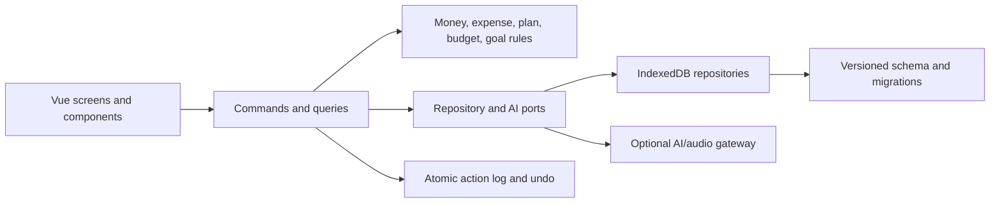

# Rushd Master Product and Technical Plan — Superseded

> **Historical plan:** This July plan is preserved for its research and technical detail,
> but it is no longer implementation authority. Founder decisions and the final researched
> plan now live in [`RUSHD_MASTER_PLAN_FINAL.md`](./RUSHD_MASTER_PLAN_FINAL.md). Agents must
> follow the final plan and machine-readable phase contract.

**Status:** Ready for founder review
**Prepared:** 11 July 2026
**Repository baseline:** `main` at `ed45d83`
**Scope:** Research, product design, architecture, and implementation planning only. No product code has been changed.

---

## 0. Start here when you wake up

### The bet

Rushd should become the **Arabic-first spending-clarity companion for Saudi students and early earners**: the fastest trustworthy way to say what happened, keep the month organized, and know what remains available according to the plan.

### What I recommend approving

- One monthly spending envelope, not bank aggregation or full accounting.
- Capture-first onboarding and a seconds-long daily loop.
- **End-state vision:** full-breadth AI that can explain and propose across expenses, plans, goals, onboarding, and insights—but cannot silently write, delete history, reset/import, or move real money.
- Rushd Rhythm instead of XP, levels, currency-derived “savings,” or punishment streaks.
- “The Rushd Measure” art direction: calm, precise, Arabic, restrained, and premium.
- A safe Vue/TypeScript modular rebuild and hardened PWA before a native wrapper.

Only four choices particularly need your personal approval or change now:

1. The focused launch audience.
2. The Rushd Measure visual direction.
3. The optional-cloud AI privacy and funding promise.
4. PWA-first publishing rather than an immediate native wrapper.

The recommended defaults are in Section 21. You do **not** need to choose the technical stack, AI/speech provider, database library, or native wrapper today; the plan defines how those are selected and verified.

Public 1.0 deliberately graduates more slowly: grounded conversation plus confirmed expense capture ship first; plan/goal/onboarding write proposals remain feature-flagged until their own evidence is strong enough.

### What happens after approval

1. Turn the approved defaults into the final master implementation prompt.
2. Run Phase 0: lock formulas, fixtures, screenshots, known bugs, and migration evidence.
3. Begin the safe split/refactor in Phase 1.
4. Review the first real milestone after Phase 4: a complete, private, beautiful daily capture–Activity–Home loop.

### How to read this document

- **Founder path (roughly 25–35 minutes):** Sections 0, 1, 3–5, 7–10, 18–21, and 23.
- **Implementation reference:** Sections 2, 6, 11–17, 22, 24, and the glossary in 25.
- **The full product:** Sections 3–10.
- **The technical/trust specification:** Sections 11–17.

This is intentionally a complete reference, not a pitch deck. The first pages and founder decisions stand on their own; later sections contain the detail needed to keep a long implementation from drifting.

---

## 1. Executive summary

### The strongest recommended direction

Rushd should become the **Arabic-first spending-clarity companion for students and early earners in Saudi Arabia**.

It should be built for a person who receives or sets aside a known amount for the month, dislikes maintaining finance apps, and wants one trustworthy answer:

> **After what I have paid and what I still need to pay, what remains available according to my plan right now?**

Rushd should not become an Arabic clone of a bank aggregator, accounting suite, investment app, or generic chatbot. Its advantage should be a much tighter loop:

> **Plan the month → say what happened → confirm it → see what changed → make one useful decision.**

The product should feel like a calm, precise companion rather than a demanding spreadsheet. The technical core should remain deterministic and auditable. AI should translate natural language into reviewable proposals, not become the source of financial truth.

The assistant has **full breadth but bounded authority**: it can help across expenses, plans, goals, onboarding, statistics, and conversation, while every financial mutation remains a visible proposal under the user’s control.

### The six decisions I recommend making now

1. **Keep the product focused on one monthly spending envelope.** Call it “money available this month,” not merely an allowance. This covers salary, scholarship, family allowance, or money deliberately set aside without adding full accounting, bank accounts, or an income ledger at launch.

2. **Make capture the first experience, not setup.** A new user should record one real expense in the first minute. Budget, recurring routines, workdays, and goals should be introduced progressively after the user has received value.

3. **Keep the ledger and financial calculations local and deterministic.** AI is optional and cloud-assisted. It receives only the smallest relevant context, produces typed proposals, and can never write directly to storage.

4. **Delete the current currency-based XP system.** Replace XP, levels, and “saved money” badges with **Rushd Rhythm / إيقاع رُشد**: an ethical system that recognizes honest review, planning, recovery, backups, and goal work—never wealth or spending less.

5. **Keep Vue, but rebuild the project as a Vue 3 + Vite + TypeScript modular monolith.** Do not rewrite it in React and do not split the monolith blindly. First lock behavior with tests, then extract one domain and one vertical slice at a time.

6. **Ship a hardened PWA first.** Add a native Capacitor wrapper only when store distribution or genuinely native capabilities—reliable local notifications, biometrics, consistent haptics, secure storage—justify it.

### The future product in one sentence

> **رُشد يفهم مصروفك بالعربية، يرتّب واقعك المالي، ويبيّن لك المتاح وفق خطتك—مع بقاء القرار بيدك.**

> Rushd understands how you talk about money, organizes the reality of your month, and shows what remains available according to your plan—while keeping every decision in your hands.

---

## 2. Research basis and current-state diagnosis

This plan is grounded in:

- A source audit of the current 10,194-line application.
- The repository documentation and open issues.
- The supplied screenshots and the committed onboarding/add-expense screenshots.
- A live mobile-browser pass at 390 × 844, including first launch and the current expense form.
- Current `npm test` results.
- Focused research into AI action safety, Arabic voice capture, PWA behavior, accessibility, financial ethics, habit formation, Saudi privacy considerations, and relevant finance products.

### What the codebase actually is today

The production app is one 507 KB HTML file:

| Area | Approximate location | Share |
|---|---:|---:|
| Inline JavaScript | utilities, translations, store, controller, gamification | 48% |
| Inline CSS | two large cascading style blocks | 24% |
| Vue template markup | all screens and modals | 28% |

The single file currently contains:

- Design tokens, layout, every screen, every modal, and two overlapping motion/CSS systems.
- Arabic and English translations.
- Money/date utilities.
- IndexedDB storage.
- Domain normalization and recurrence logic.
- The global reactive store and financial calculations.
- Root-controller behavior.
- Gamification and a mock trend chart.

The project has no production build, router, TypeScript, lockfile, CI workflow, manifest, service worker, backend, authentication, cloud sync, or model integration. Vue, Tailwind, fonts, and icons load from external CDNs.

`npm test` passes, but that does not yet mean the application is safe. The current tests check repository markers and eight examples in a separate finance helper file that the production app does not import. The browser smoke test covers one Chromium add-and-reload path.

### The deeper product diagnosis

The central problem is not merely “the UI needs polish” or “AI is missing.” The current app asks the user to operate a finance database:

- Choose dates.
- Fill fields.
- Understand templates, profiles, flexible definitions, classifications, and month assignments.
- Reconcile expected and actual spending manually.
- Navigate dense statistics and configuration screens.

The intended user wants something much simpler:

> “Let me tell Rushd what happened. Keep the month organized for me. Tell me what matters.”

That mismatch explains the procrastination. The app has useful machinery, but too much of that machinery is exposed before the user receives value.

### Important correctness findings

These are not cosmetic. They should influence the migration order.

#### Release-blocking financial/data risks

1. **Plan reconciliation can alter or delete paid transactions.** A paid generated occurrence can still be considered mutable during reapplication. Paid history must become immutable; a plan can change projections, not posted facts.

2. **Month-end surplus ignores unpaid obligations that should remain reserved.** A month can appear to have surplus even when a known bill remains unpaid. Once settled, the result is not recalculated.

3. **Vault settlement is non-atomic and non-idempotent.** A vault entry can succeed before the settlement record fails; a retry can credit the same month twice.

4. **Plan application and import are multi-write partial workflows.** Failure midway can leave a half-applied plan or half-imported database.

5. **Every savings goal currently compares itself with the entire vault balance.** The same 100 SAR can make two separate 100 SAR goals both appear complete.

6. **A legacy vault balance can disappear on the first new transaction.** Once transaction history exists, the old standalone balance is ignored.

#### High-priority logic bugs

- “Today” is based on UTC, so 12:30 AM in Riyadh can be recorded as yesterday.
- Money uses floating-point numbers despite comments implying integer-halalah arithmetic.
- Negative and excessive-precision values are weakly validated.
- Changing the current allowance rewrites the apparent budget of past months.
- A monthly template created from the Plans screen has no day-of-month and therefore never occurs.
- An assignment’s effective date is stored but ignored by some plan resolution paths.
- The Home hero follows the selected date visually but uses the real current month for its amount.
- Weekly safe-to-spend is simply monthly remaining divided by four.
- Rapid date changes can publish stale derived statistics.
- Flexible usage may use the actively edited profile rather than the plan assigned to the viewed month.
- The import validator only meaningfully checks that `expenses` is an array.
- Factory reset can hang when another tab blocks database deletion and does not clear every app-owned preference.
- The profile trend chart is hardcoded, and date activity dots are permanently disabled.

#### Current accessibility blockers

- Core date chips, expense cards, and plan headers are non-semantic clickable `<div>` elements.
- Important actions rely on swipe or long-press without equivalent single-tap and keyboard controls.
- Modals lack dialog roles, focus containment, Escape handling, background inertness, and focus restoration.
- Many visible labels are not programmatically associated with inputs.
- The viewport disables zoom.
- Several text colors are below WCAG AA contrast.
- The bottom navigation lacks navigation semantics and can obscure content.
- User-generated mixed Arabic/English names are not consistently isolated with `bdi`/`dir="auto"`.

These findings reinforce one conclusion: **the redesign must be built on a corrected financial core, not layered on top of the current global store.**

---

## 3. What Rushd should become

### Primary audience

Launch for:

- Arabic-speaking students, scholarship recipients, interns, allowance users, and first-job earners.
- People managing one dominant monthly pool of spending money in SAR.
- Users who dislike finance administration and do not want to link a bank account just to understand their month.
- Saudi Arabia first; GCC expansion later after language, calendar, currency, and recurring-obligation behavior are tested locally.

The recommended external-beta/public-launch policy is **18+**. “Students” includes university-age users; serving minors should wait for a guardian-consent, age-appropriate notice, analytics/vendor restriction, and data-rights design reviewed with Saudi counsel.

Do not initially design for complex households, business accounting, investment portfolios, multiple bank accounts, debt optimization, or irregular-business cash flow. Those are different products.

### Core job to be done

> “When I receive or set aside money for the month, help me account for what I must pay, capture what I actually spend without tedious entry, and tell me what remains available according to my plan—without judgment and without requiring bank access.”

### Product positioning

Rushd is a **coach on the surface and a precise ledger underneath**.

- The visible product emphasizes clarity, decisions, and next actions.
- The underlying engine stores exact records, rules, revisions, sources, and history.
- Every explanation can be traced to the entries and formula behind it.
- Every consequential change can be previewed, confirmed, and—where practical—undone.

### The central financial answer

Rushd should have one canonical monthly figure. In the interface, call it **المتاح وفق خطتك — Available according to your plan** rather than presenting “safe” as an unconditional affordability guarantee:

```text
available according to plan =
  money available this month
  + approved carry-in
  + confirmed refunds, reimbursements, and other inflow adjustments attributed to this month
  + confirmed amounts released from Rushd allocations into this month
  - paid cash outflows attributed to this month
  - confirmed outflow adjustments attributed to this month
  - unpaid commitments the user explicitly reserved
  - confirmed amounts allocated from this month in Rushd
```

Worked example:

```text
2,200 SAR available
+   0 SAR carry-in
- 620 SAR already paid
- 422 SAR still reserved for known commitments
= 1,158 SAR available according to the plan
```

If a reserved 250 SAR internet bill is paid for 240 SAR, its 250 SAR reserve is replaced by the 240 SAR actual payment and availability rises by 10 SAR. If the bill is genuinely cancelled, the reserve is released after confirmation. This is the product promise in concrete form: the number changes because reality changed, and the explanation shows exactly why.

Important decisions behind this formula:

- Category is descriptive; it never controls arithmetic or makes a moral judgment. An unpaid planned item has an explicit state: `reserved commitment`, `planned but not reserved`, or `needs review`. Fixed commitments may be suggested as reserved, but the user confirms that behavior and AI never silently chooses it.
- When an expected item is paid, the actual amount replaces the reserve.
- Transaction variance is described as “lower/higher than expected,” not “savings.” It counts toward a savings goal only after the user confirms a tracked allocation; Rushd still does not claim the bank money physically moved.
- Allocating money from the month into Rushd’s vault reduces the month once. Reallocating existing vault money between goals does not change the monthly figure.
- A payment belongs to the month when money actually left the user’s envelope; a reservation belongs to the month containing its due date. Late/early payments remain linked to the original expectation without rewriting either date.
- Weekly/daily values are pacing suggestions derived from the same monthly truth. They must not pretend to be a second definition of available money.
- Every period summary shows its data freshness and calculation basis.

### Completeness states

Rushd may display the green, decision-ready `المتاح وفق خطتك` state only when:

- The month’s starting amount/boundary is known.
- Known commitments have been reviewed and given an explicit reservation state.
- There are no unresolved imported/AI items that materially affect the period.
- The calculation is current and its invariants pass.

Otherwise use:

- **`المتبقي في السجلات — Remaining in your records`** for an incomplete estimate, with the missing facts beside it.
- **Unavailable** when a meaningful number cannot be calculated without pretending.

Suggested status labels: `مكتمل حتى الآن`, `ينقصه صرف سابق`, and `فيه عنصران للمراجعة`. Completeness is stored and versioned with the calculation; it is not hidden in a tooltip.

### Product principles

1. **One trusted answer before many charts.**
2. **Arabic is the originating language, not a translation layer.**
3. **Financial truth is deterministic.**
4. **AI interprets and proposes; the app validates and commits.**
5. **Consequential changes are visible, explainable, and reversible.**
6. **Capture first, structure progressively.**
7. **Incomplete months invite recovery, not shame.**
8. **Power appears when needed, not all at once.**
9. **Calm is a feature.** Premium means precision, responsiveness, and emotional safety—not visual noise.
10. **Rushd never implies custody or regulated advice.** Rushd cannot hold or move money. “Set aside” means the user confirmed that the amount was separated or assigned; the vault is only Rushd’s record of that allocation, not a real bank account or protected balance.

### Explicit launch non-goals

Do not include these in the first publishable product:

- Bank linking or open-banking aggregation.
- Multiple financial accounts or net-worth tracking.
- Investment, credit, tax, zakat, or legal recommendations.
- Bill payment or movement of real money.
- Shared household budgets.
- Mandatory sign-up or mandatory cloud sync.
- Receipt scanning at launch; add it only after text/voice capture is excellent.
- Social feeds, leaderboards, loot-like rewards, or competitive challenges.
- A general-purpose chatbot that talks without evidence or action.
- Dozens of charts and speculative forecasts.

This restraint is strategic. Products such as Drahim and Malaa already compete on Saudi bank aggregation. Rushd’s defensible wedge is **Arabic conversational capture + explicit planning + local-first trust + explainable action**.

### Exact public 1.0 scope

This prevents the roadmap from becoming an excuse to ship every researched idea at once.

| Required for public 1.0 | Beta/feature-flagged | Explicitly post-launch |
|---|---|---|
| Arabic-first UI with complete English mode | Multiple named routine profiles | Cloud sync and accounts |
| Local no-account ledger, manual capture, verified export/import | AI edits to plans, goals, and month assignments beyond expense capture | Native wrapper unless real native value is proven |
| Typed and push-to-talk single/batch expense capture across dates/months, always previewed | Spoken assistant responses | Bank/open-banking aggregation |
| Home, Activity, one active Plan/routine, commitments, flexible limits | Durable assistant memory | Multiple financial accounts/households |
| Expected versus actual, partial payment/refund support, undo/action history | Push-notification infrastructure | Investment/credit/tax/zakat advice |
| Day/week/month reviews and Rushd Rhythm | Advanced forecasting and custom payday-anchored cycles | Bill payment or external money movement |
| Vault as tracked allocation, explicit goal allocations | SMS-paste capture after privacy/duplicate tests | Receipt scanning until capture is already excellent |
| Deterministic Insights and grounded read-only financial conversation | Separate technical AI History screen; normal action history ships inside Activity | Social sharing, leaderboards, public challenges |
| Hardened offline PWA, encrypted backup option, WCAG 2.2 AA target | Milestone artwork and optional reminders | Advertising or data-funded personalization |

The first usable private daily loop exists after Phase 4. The safe planning/goal PWA beta exists after Phase 7. The deep typed/voice AI beta exists after Phase 9. Public 1.0 follows Phase 10 evidence, not a calendar promise.

### Sustainable AI business model

Recommended default:

- The local finance core—manual entry, plans, calculations, goals, reviews, backups, export, and data ownership—remains free and ad-free.
- A small opt-in AI trial lets people experience typed/voice capture.
- After beta reveals real provider cost and retention value, **Rushd Plus** can fund cloud text/voice AI through a clear fair-use allowance or subscription.
- Quota exhaustion preserves the input and falls back to local/manual capture; it never locks the ledger or hides existing data.
- Rushd never sells financial records, targets advertising from them, or quietly subsidizes AI by expanding data collection.

Exact pricing is a later commercial decision. The principle is not: core financial access must never become hostage to an AI subscription.

### What to borrow—and reject—from adjacent products

| Inspiration | Borrow | Do not copy |
|---|---|---|
| YNAB | Keep available cash, dated commitments, and goals as distinct concepts; preview allocations | Setup burden, specialized vocabulary, or mandatory every-riyal rigidity |
| Copilot Money | A prominent “needs review” inbox and correction-aware suggestions | Invisible uncertain categorization or bank-link dependence |
| Monarch Money | Reusable rules, flexible planning, and prioritized goals | Dense dashboards, long onboarding, or premature household complexity |
| Rocket Money | Turn one grounded insight into one concrete next action | Affiliate incentives, aggressive upsells, or alert fatigue |
| Cleo | Natural conversation that reduces anxiety | Sarcasm/roasting or chat detached from deterministic evidence |
| Apple Wallet/Health | Calm progressive disclosure: summary, evidence, detail | Hiding provenance behind polished cards or forcing every insight into a chart |
| Drahim/Malaa | Saudi monthly-obligation framing and plain consent language | Regulated aggregation scope or investment promotion at launch |
| Throof | SMS-paste as a possible later bridge with prefill and duplicate review | Silently trusting parsed bank messages or adding it before voice/text capture is excellent |
| Cash App Moneybot | Contextual conversational proposals with explicit confirmation | Assistant-initiated silent mutations or external money movement |

The combined Rushd workflow is: **local Arabic capture → small review inbox → explainable monthly availability → grounded conversation → proposed adjustment → preview/confirm/undo → five-card weekly review**.

---

## 4. What to preserve, replace, and remove

### Preserve and strengthen

#### 1. Arabic-first RTL foundation

Keep Arabic as the primary design language. Preserve:

- IBM Plex Sans Arabic for body/UI.
- Noto Kufi Arabic for restrained display use.
- RTL-first layout and mirrored interaction logic.
- Gregorian/Hijri display preference, after its semantics are corrected.

#### 2. Expected versus actual spending

This is one of Rushd’s best product ideas. Preserve the distinction between:

- What was planned or expected.
- What actually happened.
- Whether a scheduled expense did not happen.
- The difference between expected and actual.

Make reconciliation easier and more visible rather than removing it.

#### 3. Plan reconciliation concept

The existing planner’s create/update/delete preview is unusually good prototype work. Preserve the concept, but rewrite its safety contract:

- Paid/posted records are never rewritten or deleted by a plan.
- Manual records are never silently absorbed into a template.
- User-edited generated occurrences remain protected.
- Each addition, update, removal, and conflict is inspectable.
- Applying a plan is atomic, idempotent, and undoable as one action.

#### 4. Local-first posture

Preserve:

- Immediate local writes.
- Offline-capable financial calculations.
- Export/import/reset ownership.
- The ability to use the core app without an account or AI.

#### 5. Theme and motion preferences

Keep dark and light modes and reduced-motion support. Simplify the choices and make the implementation complete.

#### 6. The date strip and category recognition

The compact date context and recognizable category icons are useful. Redesign them with better semantics, density, and accessibility rather than discarding them.

### Replace or heavily rethink

#### Current onboarding

Replace the setup marathon with first-value onboarding and progressive profiling. The live mobile audit confirmed that the second step tries to expose plan selection, work/off days, effective date, and three separate item editors inside one long modal before the user has logged anything.

#### Statistics dashboard

Replace a wall of zero-valued cards with interpreted insight. No chart should appear without enough data. Every insight should follow:

> **Conclusion → evidence → optional action**

#### Vault and goals

Replace the current “every goal uses the full vault” model with explicit tracked allocation:

- Total vault balance.
- Amount allocated to each goal.
- Unallocated balance.
- Signed allocation/release history, with explicit no-custody wording.

#### Plans vocabulary

Hide terms such as “template definition,” “profile assignment,” and “flexible source” from the normal user. Show:

- Monthly funds.
- Commitments.
- Routines.
- Spending limits.
- Plan changes to review.

#### Navigation

Remove Settings and dense Statistics from permanent bottom tabs. Promote capture and the activity ledger.

### Delete

- Currency-derived XP.
- Levels and wealth/status titles.
- Confetti for spending below an estimate.
- The fake trend chart.
- “Savings” copy for mere expected-vs-actual variance.
- Decorative activity dots that do nothing.
- The generic red glowing modal close button.
- The generic piggy-bank Material icon as the primary brand mark; replace it with a custom Rushd mark derived from guidance/measurement while preserving the orange brand presence.
- Ambient mesh animation, constant glows, and glass blur on ordinary surfaces.
- Duplicate Settings entry points and root-tab back buttons.
- Production CDN/runtime Tailwind dependencies.

---

## 5. Ideal user journey

### First launch: useful in under 60 seconds

#### 0–8 seconds: one job and one trust promise

The first screen should say:

> **وش صرفت آخر مرة؟**
> اكتبها بطريقتك — رُشد يرتّبها لك. سجلك يبقى على جهازك، وإذا احتجنا الذكاء السحابي نطلب إذنك أولاً.

> **What did you spend most recently?**
> Type it your way—Rushd will organize it. Your ledger stays on this device; Rushd asks first if cloud AI is needed.

The text field is focused. Example:

> قهوة 18، وأوبر 27 أمس

Secondary actions:

- `ما عندي مصروف أضيفه الآن / Nothing to add now`
- `عندي إعداد جاهز / I already have a setup`
- `إدخال يدوي / Manual entry`

Do not ask for an account, notifications, workdays, goals, or an AI permission before the user has tried the first action.

#### 8–30 seconds: interpret and review

Rushd first uses a deliberately limited local parser. If the sentence needs cloud interpretation, show a concise just-in-time sheet **before transmission**: `سنرسل هذا النص إلى [provider] لفهم المصروف فقط`, with `متابعة` / `استخدام الإدخال اليدوي`. A visible `التفاصيل` disclosure provides the exact fields, purpose, retention, and cross-border facts before consent. Declining keeps the sentence as an editable local draft.

Measure the under-60-second target separately for local/manual and cloud-assisted first capture; provider permission/network latency must not be hidden inside a misleading universal claim.

Rushd converts the sentence into editable cards:

```text
قهوة     18 ر.س     اليوم     مدفوع
أوبر     27 ر.س     أمس       مدفوع
```

It shows `لقيت مصروفين بقيمة 45 ر.س` and asks once: `حفظ المصروفين`.

Nothing is saved silently.

#### 30–45 seconds: first success

The cards settle into Activity/Home. The app celebrates clarity, not spending:

> **تمام، صارت الصورة أوضح.**
> سجّلنا 45 ر.س.

#### 45–60 seconds: ask only what unlocks immediate value

> عشان أحسب المتاح لك: كم المبلغ المخصص لمصاريفك هذا الشهر؟

If skipped, the app still works. It does not silently use the current fake default of 1,000 SAR.

#### Starting mid-month: establish an honest boundary

If the user starts after the first day of the month, one recent expense plus the original monthly amount would create a dangerously optimistic result. Ask one quick choice:

- `أبدأ من اليوم بالمبلغ المتبقي معي` — enter what remains now; earlier spending is outside the starting boundary.
- `أدخل مبلغ الشهر وأراجع ما سبق` — enter full monthly funds and complete a short catch-up.
- `لست متأكداً` — keep tracking, but label the headline `المتبقي في السجلات` and show what is missing.

The 1.0 financial cycle remains the Gregorian calendar month. This starting-boundary flow handles mid-month entry; custom payday-anchored cycles wait for beta evidence.

### Progressive setup after first value

Rushd asks a question only when the answer unlocks an immediate benefit:

1. Monthly funds/start boundary after first capture → unlock plan-based availability.
2. Repeated merchants/expenses after a few sessions → offer a shortcut or recurring rule.
3. Work/off days only when a routine needs them.
4. Monthly commitments when the user asks for a better forecast.
5. Goal setup only when the user expresses saving intent or closes a positive month.
6. Notification permission only after the user chooses a review schedule.
7. AI cloud consent immediately before the first cloud-assisted action, not at app launch.

### Natural-language setup for an existing routine

The advanced onboarding route should accept:

> مصروفي لهذا الشهر 2200. دوامي الأحد للخميس. قهوة 18 في يوم الدوام، إنترنت 250 يوم 5، وحلاق 80 مرتين بالشهر.

Rushd returns a review sheet:

- Money available: 2,200 SAR.
- Workdays: Sunday–Thursday.
- Workday routine: coffee, 18 SAR.
- Monthly commitment: internet, 250 SAR, day 5.
- Flexible limit: haircut, 160 SAR / 2 uses.

Ambiguity is resolved visibly. For example, “twice a month” may mean a 160 SAR limit or simply two reminders. Rushd asks rather than guessing.

### Daily use

The daily loop is designed to take seconds:

1. User spends money.
2. User types or says one sentence.
3. Rushd previews the interpretation.
4. User confirms.
5. Plan-based availability and the day list update.
6. Undo remains available.

If a planned item remains unresolved in the evening:

> **نقفل اليوم؟**
> عندك قهوة 18 ر.س مجدولة.
> `اندفعت` · `ما صارت` · `تعديل المبلغ`

If nothing happened, “No expenses today” is a valid completed review.

### Weekly session: five cards, one decision

The weekly review should take about five minutes and show no more than:

1. Items needing reconciliation.
2. Plan-based availability and upcoming commitments.
3. One meaningful change.
4. One goal/routine status.
5. One choice for next week—or `لا تغيير`.

Do not manufacture an insight when data is incomplete. Say so and offer recovery.

### Month end: reconcile, understand, decide

The month close becomes a deliberate three-step flow:

1. **Reconcile:** Resolve unpaid commitments, cancelled planned items, and estimates.
2. **Understand:** Show funds, actual paid, known commitments, data completeness, and one grounded observation.
3. **Decide:** Carry forward, allocate to savings goals, leave unallocated, or explicitly start the next month fresh.

No remainder is allocated automatically.

A late payment after close is recorded on the day money actually left and linked to the earlier commitment. Correcting a closed month shows every affected carry/allocation before creating a correcting close; Rushd never silently rewrites later months.

### Returning after a lapse

After several missed days:

> **ولا يهم. نكمل من اليوم؟**
> `ابدأ من اليوم` · `أضف تقديراً` · `راجع آخر 3 أيام`

After a longer lapse, Rushd must never require the user to clear a huge backlog before regaining value.

---

## 6. Full AI assistant vision

### The role of AI

Rushd’s AI is a **language, interpretation, and explanation layer**. It is not:

- The financial calculator.
- The database.
- The authorization system.
- A hidden automation engine.
- A substitute for confirmation.

The governing architecture is:

```text
Text or microphone
  → final transcript and locale normalization
  → intent and slot extraction
  → scoped local data retrieval
  → typed intent draft or mechanically grounded answer
  → trusted local policy translates intent into permitted operations
  → deterministic validation and before/after calculation
  → visible proposal
  → user confirmation
  → atomic local command
  → receipt, audit history, and undo
```

OpenAI’s current guidance recommends strict function schemas for reliable tool arguments, and Structured Outputs for schema adherence rather than merely valid JSON. It also distinguishes chained voice pipelines—which preserve visible transcription and deterministic stages—from direct speech-to-speech sessions. That makes a chained pipeline the right first choice for approval-heavy financial capture: [function calling](https://developers.openai.com/api/docs/guides/function-calling), [Structured Outputs](https://developers.openai.com/api/docs/guides/structured-outputs), and [voice-agent architecture](https://developers.openai.com/api/docs/guides/voice-agents).

### Hard safety boundary

> **The model may read a minimized, approved snapshot and return typed intent/requested changes. It never creates trusted commands and can never call IndexedDB, localStorage, import/reset, or a storage-writing function.**

The trusted local application owns:

- Record lookup and identity.
- Money arithmetic.
- Date/calendar conversion.
- Formula evaluation.
- Validation.
- Proposal impact.
- Confirmation state.
- Commit and rollback.
- Audit and undo.

Strict output schemas prevent malformed arguments; they do not prove that a semantically valid change was requested or safe. The model therefore extracts **intent and fields**, while a trusted local policy layer constructs the permitted operation set and enforces scope. It applies hard limits to record count, date span, amount magnitude, and batch size; an oversized request is split into reviewable groups or rejected.

### Assistant capabilities by rollout tier

#### Tier A — read and explain

Ship first:

- “How much remains available according to my plan?”
- “Why did this number change?”
- “Where did most of my money go this month?”
- “Which commitments are still unpaid?”
- “How is my laptop goal progressing?”
- Deterministic “what if” scenarios.

Every numerical answer includes:

- Date range.
- As-of time.
- Formula version.
- Data completeness.
- Links to the relevant entries.

The model receives precomputed evidence objects with stable evidence IDs. Any amount/date shown in the final answer is injected from or checked against those objects. Unsupported numerical claims are rejected rather than presented as plausible prose.

#### Tier B — typed expense proposals

- Single paid expense.
- Planned future expense.
- Batch expenses across dates/months.
- Match a paid expense to a planned occurrence.
- Edit, mark paid/unpaid, or correct an expense.

#### Tier C — structured planning and goals

- Build onboarding configuration.
- Create/edit recurring routines.
- Create/edit flexible limits.
- Assign a plan to a month.
- Create/edit savings goals.
- Prepare a month-close decision.

#### Tier D — voice

- Push-to-talk expense capture.
- Voice correction and follow-up.
- Spoken read-back for simple proposals.
- Optional conversational voice only after the text/action system is proven safe.

#### Permanently outside initial AI control

- Factory reset.
- Backup import/replace.
- Real bank/payment movement.
- Authentication/security changes.
- Cloud-sync enablement.
- Investment, credit, tax, legal, or regulated financial direction.

The assistant may navigate the user to a native screen for these operations, but it cannot commit them.

### Conversational coaching contract

Rushd should support genuine discussion, not merely command parsing. Every financial answer follows:

> **Direct answer → ledger evidence → assumptions/completeness → one optional action**

Examples:

**“Why do I always run short near month end?”**

- Direct: `في آخر شهرين، المصروفات غير المخططة ارتفعت بعد يوم 20.`
- Evidence: show the two periods and exact categories/entries.
- Limits: `يونيو ناقصه 4 أيام مراجعة، لذلك المقارنة تقريبية.`
- Action: `هل تبغى نجرب حجز 120 ر.س للأسبوع الأخير في خطة أغسطس؟` → proposal only.

**“Can I buy this for 300 and still cover my commitments?”**

- Show two deterministic scenarios: current plan and after 300 SAR.
- State unresolved commitments and whether the starting month is complete.
- Never answer “yes, you can afford it” as a guarantee; say what remains according to recorded assumptions.

**“Help me make next month more realistic.”**

- Compare expected versus actual routines.
- Identify at most two material mismatches.
- Ask which change reflects reality.
- Produce a Plan proposal with exact monthly impact.

**“I feel like I keep failing at this.”**

- Acknowledge without diagnosing or inventing a personality trait.
- Ground the response in recoverable facts: missing days, unrealistic plan, or incomplete records.
- Offer one low-pressure action such as starting from today or revising one commitment.

The assistant may ask reflective questions and compare scenarios. It must not moralize, produce generic motivational filler, infer psychological traits, or interrupt proactively with a chat overlay. Conversation remains user-initiated and evidence-linked.

### Read tools

Expose small, purpose-built tools rather than one generic database query:

| Tool | Purpose |
|---|---|
| `get_app_context` | Locale, timezone, currency, calendar preference, visible period |
| `query_expenses` | Capped, explicit filters and date range |
| `resolve_expense_reference` | Return ranked candidates; never mutate |
| `get_budget_summary` | Deterministic monthly calculation |
| `get_statistics` | Supported metric over an explicit period |
| `list_plan_profiles` | Names and identifiers only |
| `list_plan_rules` | One selected plan/range |
| `preview_plan_application` | Deterministic creates/updates/removals/conflicts |
| `list_goals` | Targets, allocations, progress |
| `get_onboarding_gaps` | Missing fields only |

Every result is minimized, capped, revisioned, and marked with `asOf`, date range, and formula version.

### Proposal tools

Tool names should make the trust contract obvious:

- `draft_expense_changes`
- `draft_plan_changes`
- `draft_flexible_limit_changes`
- `draft_month_assignment`
- `draft_goal_changes`
- `draft_onboarding_configuration`

Avoid names such as `save`, `delete`, or `updateDatabase`. These schemas describe the user’s desired outcome and extracted fields—not database operations. The trusted app resolves targets, checks that the result is within the current turn’s scope, and creates the authoritative operations/proposal.

Each draft includes:

```json
{
  "schemaVersion": 1,
  "requestedChanges": [],
  "intentSummary": "...",
  "assumptions": [],
  "unresolvedFields": [],
  "sourceTurnId": "..."
}
```

The model never supplies authoritative totals, database revisions, final record IDs, or permission. User/imported text is carried in tagged data fields, never concatenated into instructions. The assistant has no arbitrary URL/network tool and all retrieval is capped.

### Proposal UX

Every write produces a preview, including one expense.

#### Simple example

> **إضافة مصروف**
> قهوة — 18 ر.س — مدفوع — 11 يوليو 2026
> الفئة: طعام
> `تعديل` · `حفظ المصروف`

#### Batch example

> **14 عملية**
> 12 إضافة · تعديل واحد · حذف واحد
> النطاق: 1 يوليو–15 أغسطس 2026
> أثر يوليو: −240 ر.س · أثر أغسطس: −90 ر.س

Batch controls:

- Expand all.
- Edit one row without regenerating the rest.
- Exclude selected rows.
- Show assumptions and warnings.
- Confirm/cancel.

All impact values come from deterministic replay against the current snapshot.

### Ambiguity and confidence

Do not show fake confidence percentages. Internally track confidence per field plus its provenance:

- **Explicit:** directly stated by the user.
- **Matched:** linked to a known record/routine.
- **Inferred:** suggested from context/history.
- **Needs review:** missing, conflicting, or ambiguous.

Policy:

- High-confidence, complete request → show proposal.
- One bounded ambiguity → show two or three selectable interpretations.
- Missing critical field or multiple candidate records → ask one focused question.
- Contradiction → stop and explain.
- No match for an edit/delete → never silently create a new record.

Always clarify:

- Ambiguous dates such as `الخميس` or a Hijri date without year.
- Ambiguous amount separators.
- Multiple matching expenses/routines.
- Whether an amount is expected or actually paid.
- Whether a returned amount is a refund/reimbursement and which original expense it links to.
- Whether a date is the commitment’s due date or the day money actually moved.
- Multi-month changes not clearly requested.
- Destructive phrases such as “delete the coffee expenses” without a defined range.

Arabic has specific ambiguities the eval suite must cover. For example, `غدا` may represent “tomorrow” (`غدًا`) or “lunch” (`غداء`). The assistant must display the interpreted full date/name and ask when context is insufficient.

### Confirmation tiers

| Tier | Examples | Required confirmation |
|---|---|---|
| C0: Read-only | Explain, search, statistics, what-if | None |
| C1: Small/reversible | One exact create/edit/payment toggle | Inline preview + explicit visible tap at launch |
| C2: Material/destructive | Any delete, batch, multi-month, plan, budget, or goal change | Expanded impact preview + explicit tap; voice alone is not enough |
| C3: Critical | Reset, import/replace, future external money movement, destructive cloud/security change | Dedicated manual screen + fresh typed confirmation and verified-backup prompt where relevant; real reauthentication only where actually configured; AI cannot commit |

An imperative sentence such as “add coffee for 18” authorizes a proposal, not a silent write.

Internal month-close/vault allocation is C2 bookkeeping—not external money movement. It requires an expanded tap confirmation, atomic action, and correction/undo path. Voice-only confirmation is excluded from public 1.0; it may be reconsidered only after foreground/unlocked/replay/spoof evaluation and never when a consequential field was inferred.

### Commit, idempotency, audit, and undo

Each proposal receives a single-use `ConfirmationEnvelope` containing:

- Proposal ID and expiry.
- Read-set revisions/hashes for the records and aggregates actually consulted.
- Relevant period-calculation revision; a global book/schema revision only for broad migrations/plan applications.
- Canonical operations.
- Exact before/after values.
- Risk tier.
- Formula/completeness version.
- The exact preview data rendered to the user.
- Idempotency key and envelope hash.

On confirmation, the application:

1. Re-reads affected records.
2. Invalidates a stale proposal; it computes a visibly marked new preview and requires fresh confirmation.
3. Verifies that the visible preview hash matches the exact operations to commit.
4. Commits the confirmed envelope locally without another model or network call.
5. Executes the complete batch in one IndexedDB transaction.
6. Writes the consumed idempotency key, result, compact action record, and inverse/compensating command in the same transaction.
7. Returns a receipt and undo token.

Repeated taps, network retries, or repeated model calls must return the original outcome rather than duplicate it.

Undo is a new compensating action, not deletion of history. If later edits conflict, Rushd shows a correction preview rather than pretending a safe undo is possible.

### Voice architecture

Start with explicit, foreground recording and a chained pipeline. Provide both a labelled **tap to start / tap to stop** flow and hold-to-talk as an optional accelerator; sustained pointer contact is never required:

```text
microphone
  → streaming/final transcription
  → editable transcript
  → the same typed interpretation pipeline
  → proposal
  → confirmation
```

Do not start with an always-listening assistant or direct speech-to-speech financial actions. OpenAI’s current voice guidance explicitly describes chained pipelines as a better fit when intermediate text, approvals, durable transcripts, and deterministic logic matter.

Required voice states:

- Permission explanation.
- Ready.
- Listening.
- Finalizing.
- Editable transcript.
- Parsing.
- Review ready.
- Needs attention.
- Saving.
- Saved + undo.
- Permission denied/no speech/noisy/offline/provider error.

Releasing a held microphone or tapping Stop ends transcription; it never saves.

Support Saudi/Gulf Arabic, MSA, English, and within-sentence code-switching. Handle Arabic/Western digits, number words, halalas, merchant variants, and relative/Gregorian/Hijri dates. Test Najdi, Hijazi, Eastern/Saudi Gulf, neighboring Gulf, and MSA separately.

For launch, cap one recording at roughly 30 seconds and one proposal at 10 records; larger requests split into multiple reviewed batches. Limits are server- and client-enforced, not prompt suggestions.

The provider must be selected by a local benchmark, not marketing. OpenAI transcription supports Arabic, but Rushd should compare at least two providers on business-field accuracy: exact amount, date, batch count, paid/pending state, and correction time—not word-error rate alone.

### AI privacy and memory

The current product is genuinely local-only. AI must be a clearly optional expansion of that promise.

Defaults:

- AI off until just-in-time consent.
- Text, microphone, spoken output, and durable personalization are separate choices.
- Show what is being shared on first use and make detail available per request.
- Build context locally; send aggregates by default.
- Do not upload the whole ledger or a backup for ordinary questions.
- No permanent provider API key in the PWA.
- Delete Rushd-controlled raw-audio buffers after transcription by default and disclose any provider-side retention separately.
- Use `store: false` where supported and disclose actual provider retention truthfully.
- No provider-hosted long-term conversation object by default.
- No advertising, lending, eligibility, or training opt-in from financial records.

OpenAI states that API data is not used for training unless explicitly opted in, while default abuse-monitoring logs can retain customer content for up to 30 days. Zero Data Retention is approval-based, not something Rushd can casually promise: [OpenAI data controls](https://developers.openai.com/api/docs/guides/your-data).

Memory boundaries:

- **Ledger truth:** local finance entities only.
- **Session context:** current conversation, short-lived.
- **Durable preferences:** only explicit, visible items.
- **No hidden inferred memory:** no inferred salary, religion, family role, debt, personality, or financial health.
- A “What Rushd remembers” screen allows view/edit/delete.

### Offline/degraded AI

Offline core functionality remains complete:

- Manual entry.
- All finance calculations.
- Plans, goals, review, audit, and undo.
- A small deterministic local parser may support clearly documented simple commands.

When AI is unavailable:

- Preserve the typed transcript/draft locally.
- Offer manual entry immediately.
- Do not guess.
- Do not silently queue raw audio or sensitive prompts for later transmission.
- Never retry a financial commit through the model; local commits are separate and idempotent.

### AI evaluation and rollout

Before any writes, create a versioned Arabic-first evaluation suite covering:

- Single and 10-item batches.
- Arabic dialects, MSA, English, and code-switching.
- Arabic-Indic/Western digits and spoken decimals.
- Relative, Gregorian, Hijri, ambiguous, midnight, leap-year, and month-boundary dates.
- Paid versus planned.
- Same-name expenses/templates.
- Prompt injection inside merchant names and imported records.
- Duplicate retries and stale proposals.
- Privacy scope and consent revocation.

Zero-tolerance gates:

- No mutation without trusted confirmation.
- No direct storage access from model-facing code.
- No partial batch commit.
- No duplicate effect under replay.
- No model-authored financial arithmetic.
- No target substitution on ambiguous edit/delete.
- Audit and undo present for every assistant commit.

Rollout order:

1. Read-only answers.
2. Shadow-mode drafts with no commit control.
3. Typed single-expense proposals.
4. Typed batch/edit proposals.
5. Plans and goals.
6. Voice capture.
7. Voice confirmation only after measured safety.

Use trace and dataset evaluations on every prompt/model/tool change; OpenAI’s current agent-evaluation guidance recommends trace grading during debugging and repeatable datasets for regression testing: [agent evals](https://developers.openai.com/api/docs/guides/agent-evals).

---

## 7. Screen-by-screen product plan

### Mobile information architecture

Recommended bottom navigation, ordered for RTL:

1. **الرئيسية — Home**
2. **النشاط — Activity**
3. **رُشد + — central capture/assistant action**
4. **الخطة — Plan**
5. **الأهداف — Goals**

Physically, Home sits on the right edge, then Activity, with Rushd+ centered; Plan and Goals continue toward the left edge. LTR reverses the physical layout while preserving the semantic order.

Profile/settings lives in the Home header. Insights—and the feature-flagged advanced AI History view—are pushed screens. Public 1.0 shows confirmed assistant actions in Activity history. The center action opens a sheet; it is not a conventional destination tab.

This gives the highest-frequency work—capture and transaction review—prime placement while removing Settings and empty statistics from permanent navigation.

### 7.1 Home

Home answers three questions:

1. What remains available, and how complete is the answer?
2. What needs attention today?
3. What is the next useful action?

Recommended composition:

```text
[Rushd / greeting]                              [profile]

┌ Available according to your plan ───────────────────┐
│ 958 SAR                                              │
│ [Rushd Measure: funds → committed → paid → available]│
│ Paid 620 · reserved 422            [How calculated] │
│ Complete so far · updated now                        │
└──────────────────────────────────────────────────────┘

[seven-day date strip]

Today
[planned/unpaid row]                         [Mark paid]
[paid row · expected vs actual]

[3 items need review ›]

Nearest goal
[goal measure + add allocation]

One Rushd insight
[conclusion] [evidence] [optional action]

[Close today · shown only when contextually useful]
```

Rules:

- The headline number always matches the visible month/as-of date.
- Its label/status follows the completeness policy; incomplete records never receive a confident “safe” presentation.
- The explanation drills into exact commitments/transactions.
- Home shows only one insight.
- Zero values never masquerade as meaningful analysis.
- The empty state’s main action is capture, not “auto-fill.”
- Loading never shows 0 as a placeholder; use a skeleton or last verified value.

### 7.2 Activity

Activity is the authoritative human-readable ledger.

Features:

- Group by day with paid/planned totals.
- Search by name/category.
- Filters: all, needs review, unpaid, partially paid, paid, refunded, from routine, estimates.
- Month/date range selector.
- Review inbox for unresolved scheduled items, imports, and AI assumptions.
- Bulk selection only here, not on Home.
- Detail screen with due date, each actual payment/refund date, gross/net actual, source, category, history, and plan linkage.
- Actions for partial payment, correction, linked refund/chargeback, and closed-period correction preview.

Important edit distinction:

> `تغيير هذه المرة فقط` versus `تعديل الروتين مستقبلاً`

Changing one coffee must not silently rewrite every future coffee.

Swipe gestures may reveal actions, but they never instantly execute a destructive action. Every action has an equivalent visible button and keyboard path.

### 7.3 Rushd+ capture/assistant sheet

Initial sheet:

```text
كيف أساعدك؟

[Say what you spent] [Type naturally]
[Manual entry]

“دفعت 18 ريال قهوة اليوم”
[message field] [send]
```

Long-press can start push-to-talk as an accelerator, but voice must also be discoverable through a labelled button.

The sheet grows with the conversation. A pending proposal prevents accidental swipe-down loss, but never traps the user: closing offers `احتفظ بالمسودة` or `تجاهل المسودة`. Proposal expiry warns without discarding edits and offers a fresh preview. On success, the proposal compresses to:

> `تم تسجيل 18 ر.س · تراجع`

Manual fallback defaults to:

- Amount.
- Name.
- Category.

Expected amount, reservation state for future items, recurrence, notes, and plan linkage live under “More details.” The user should never choose “manual/flexible/template source” before recording the expense.

### 7.4 Plan

Plan combines the monthly budget and recurring behavior.

Sections:

1. Money available this month and carry-in.
2. Reserved commitments.
3. Active routine for this month.
4. Workday/off-day/monthly recurring items.
5. Flexible spending limits.
6. Plan changes needing review.

Normal users see “routine,” “monthly item,” and “spending limit.” Multiple plan profiles such as University/Vacation remain an advanced capability.

#### Reconciliation review

When a plan changes, show:

- Effective range.
- Additions.
- Updates.
- Removals.
- Conflicts/protected items.
- Per-row exclude/keep controls.
- Final impact summary.

Guarantees:

- Paid history never changes.
- Manual entries never change.
- User-edited occurrences remain protected.
- Past dates stay unchanged by default.
- Apply is atomic/idempotent.
- Undo reverses the whole application where revisions permit.

### 7.5 Goals and tracked allocations

Use honest terminology: `الخزنة` can remain a friendly brand label only if it is always paired with `مبالغ مخصصة في رُشد` and a clear statement that Rushd neither holds nor moves the money.

Screen:

- Total vault balance.
- Allocated across goals.
- Unallocated balance.
- Goal cards with target, allocated amount, optional date, and optional required pace.
- Allocate/release/reallocate actions.
- Signed history.

Deleting a goal does not delete money. The user chooses whether its allocation returns to unallocated balance or another goal.

Month-end may propose a split, but the user confirms it.

### 7.6 Insights

Insights is opened from Home or the monthly-availability explanation.

Only answer:

- Where did money go?
- Am I ahead or behind the plan?
- What changed?
- What is likely by month end?
- What single action is available?

Every insight follows:

1. Plain-language conclusion.
2. Exact evidence.
3. Drill-down into Activity.
4. Optional action.

Forecasts are ranges with assumptions and completeness—not exact-looking predictions.

### 7.7 Weekly and monthly review

Reviews are dedicated guided flows, not another dashboard.

- Daily review: 20–60 seconds.
- Weekly review: five cards, one explicit decision.
- Month close: reconcile, understand, decide.

They produce a review record used by Rushd Rhythm and future comparison logic.

### 7.8 Profile and settings

Settings contains preferences and trust controls only:

- Language, calendar, numeral/currency format.
- Theme and motion.
- Notifications and quiet hours.
- Privacy and AI permissions.
- What Rushd remembers.
- Local storage/persistence status.
- Backup/export/import/reset.
- About/limitations.

Budget belongs in Plan. Routine behavior belongs in Plan. Settings must not be a dumping ground for product logic.

### 7.9 Advanced AI History (feature-flagged)

AI History is an audit interface, not a second ledger.

Show:

- Original text/transcript reference.
- Parsed proposal.
- User edits.
- Final confirmed action.
- Affected records.
- Undo/reversal status.

Model, schema, evidence, and formula IDs live under `تفاصيل تقنية`; ordinary users see the human-readable request → interpretation → edits → confirmed action chain.

Rushd does not keep raw audio by default; provider-side retention is governed/disclosed separately.

### 7.10 Empty, loading, error, and stale states

Every state must explain what happened and what the user can do:

- No monthly funds → `حدد مبلغاً تقريبياً—تقدر تعدله لاحقاً`.
- No expenses → `ما سجلنا أي صرف اليوم` + capture.
- Filtered Activity empty → clear filters.
- Plan empty → guided starter routines, not four zero-count cards.
- Goals empty → ask what the user wants to prepare for.
- Insufficient insight data → state the threshold/reason.
- AI unavailable → preserve input and offer manual entry.
- Save failure → retain fields, show retry, no false success.
- Calculation failure → show last verified value and timestamp.
- Import failure → identify version/validation problem and guarantee no change occurred.

---

## 8. Mobile-first and native-feeling plan

Rushd should be designed as a phone product first, not as a desktop page squeezed into a narrow viewport. “Native-feeling” does not mean copying iOS or Android decoration. It means that the app respects the physical device, responds immediately, behaves predictably, and makes every common task possible with one thumb.

Phones remain a focused single column. Tablets may use a list/detail split for Activity, Plan, and Goals. Desktop keeps a bounded, calm app canvas with optional list/detail—not a dense analyst dashboard or a row of stretched mobile cards.

### Interaction model

- Primary actions sit in the lower, reachable half of the screen.
- The persistent navigation contains only the five destinations defined earlier. Secondary destinations are pushed screens, not more tabs.
- Rushd+ opens as a bottom sheet on phones and a centered panel on larger screens.
- Sheets have a visible handle, a clear title, a close action, predictable snap points, and safe-area padding.
- Back gestures and the browser/device Back action close the topmost sheet or pushed screen before leaving the app.
- Destructive actions are never placed beside the primary confirmation.
- Every swipe or long-press action has a visible equivalent.
- A newly saved item appears in place; the page does not unexpectedly jump to the top or reset filters.
- Keyboard entry preserves the draft when the keyboard closes, the app backgrounds, or AI fails.

### Touch, keyboard, and viewport behavior

- All essential targets are at least 44 by 44 CSS pixels, with additional spacing between destructive and safe actions.
- Use `100dvh`, safe-area insets on all four sides, and `visualViewport` handling for keyboard-sensitive sheets.
- Keep pinch-to-zoom enabled. Never use a viewport declaration that disables user scaling.
- Use numeric/decimal input modes for money without assuming the keyboard emits Western digits.
- Scroll only one primary surface at a time. Avoid a scrolling sheet inside a scrolling page unless the sheet is full-height.
- Preserve input focus and cursor position during validation.
- The focused field must remain visible above the software keyboard.
- Hardware keyboard users receive logical Tab order, Escape behavior, and visible focus.

### Navigation and transitions

Navigation should feel spatial:

- Tab changes cross-fade with a restrained 180–220 ms transition.
- Opening an item moves forward into detail; Back returns to the same scroll position.
- Bottom sheets rise from the action that summoned them.
- Saving a proposal morphs it into a receipt and then into the affected list entry.
- Monthly-availability changes animate only the digits that changed and the corresponding measurement segment.

The system must remain fully understandable with animation disabled. Motion explains hierarchy and causality; it is never a reward for spending money.

### Haptics and sound

Haptics should be progressive enhancement:

- Light feedback on a supported native wrapper for a confirmed toggle or valid snap.
- Success feedback only after durable commit—not when the user merely taps Save.
- Warning feedback for destructive confirmation, never repeated.
- No haptics for ordinary scrolling, every number change, or decorative motion.

Do not depend on web vibration because support, especially on iOS, is inconsistent. Rushd should ship silently by default; sound is unnecessary for the core product.

### Perceived performance

The app should respond to touch within one frame even if work continues afterward:

- Preserve and show the input immediately. Show a local parse only when it independently meets the required confidence; otherwise show a clear interpreting state. Build the authoritative proposal only after typed intent is available. If the local path succeeds first and cloud is unnecessary, avoid/cancel the cloud request.
- Use skeletons only when the layout is genuinely unknown; otherwise preserve the last verified content with a freshness label.
- Optimistic UI is allowed only when rollback is real and visible. Financial writes should usually show a very brief committing state and then a durable receipt.
- Preload the next likely local view, not private cloud data.
- Virtualize Activity only after measurement proves it necessary; a simple paged/local indexed query is safer first.

### PWA first, native wrapper later

The recommended progression is:

1. A high-quality installable PWA with a bundled app shell, offline core, safe updates, and correct mobile layout.
2. Android store distribution only if discovery is valuable; a Trusted Web Activity is acceptable when the PWA itself is complete.
3. A Capacitor wrapper when Rushd gains real native value: reliable scheduled reminders, biometrics/app lock, secure key storage, richer share/import flows, and consistent haptics.

Do not wrap an unfinished website merely to claim an App Store presence. Apple review and user expectations require the native package to provide a meaningful app experience.

---

## 9. UI and art direction: “The Rushd Measure”

### The chosen visual idea

The proposed direction is **مِقياس الرُشد — The Rushd Measure**: a calm, precise Arabic financial instrument.

Rushd already has a recognizable dark, indigo, orange, and green identity. The redesign should mature that identity rather than erase it. The signature element becomes a thin right-to-left **measurement rail** used only when a real quantity, threshold, or rhythm exists:

- Home: monthly funds → reserved commitments → paid/returned → available according to plan.
- Plan: planned commitments and flexible room.
- Goal: unallocated vault money and goal allocation.
- Insights: actual versus expected.
- Rhythm: reviewed days across the recent period.

The rail should not appear as decoration on every card. Its restraint is what makes it ownable.

### Emotional qualities

The interface should feel:

- Calm, not sleepy.
- Precise, not clinical.
- Premium, not ornamental.
- Warmly Arabic, not a translated Western dashboard.
- Confident, not judgmental.
- Alive when data changes, quiet when the user is reading.

### Color system

Recommended dark theme:

| Role | Color | Use |
|---|---:|---|
| Canvas | `#090B14` | App background |
| Surface | `#111522` | Primary cards and sheets |
| Raised | `#181D2C` | Selected/raised controls |
| Hairline | `#293044` | Boundaries and dividers |
| Primary text | `#F3F4F1` | Headings and critical values |
| Secondary text | `#A1A8B7` | Supporting labels |
| Indigo | `#5C63D6` | Structure, selection, navigation |
| Orange | `#EE922B` | Current/next action and brand warmth |
| Green | `#28A47A` | Confirmed availability or completion |
| Danger | `#D65E6D` | Errors and destructive actions |

Recommended light theme uses cool paper rather than pure white:

| Role | Color |
|---|---:|
| Canvas | `#F4F6FA` |
| Surface | `#FFFFFF` |
| Raised | `#EAEDF4` |
| Hairline | `#D9DEE8` |
| Primary text | `#171B29` |
| Secondary text | `#687083` |
| Indigo | `#494FB7` |
| Orange | `#B75B08` |
| Green | `#157B5A` |
| Danger | `#B74758` |

Color must never be the only carrier of meaning. Each state also needs text, shape, icon, or position. Every combination must meet contrast requirements before it enters the token set. The indigo structural accent is not used as normal-size text on the dark surface without a higher-contrast treatment.

### Typography

Keep the Arabic fonts, with clearer roles:

- **Noto Kufi Arabic**, weight 600–700: restrained display headings, section names, and the brand wordmark.
- **IBM Plex Sans Arabic**, weight 400–600: all Arabic interface and body text.
- **Sora**, weight 500–600: English interface text if a distinct English face is desired.
- **IBM Plex Mono**, weight 500–600: tabular amounts, dates, and compact data.

The current stack mixes too many Latin voices. Remove Inter, Outfit, and JetBrains Mono rather than letting different screens drift. Use tabular numerals and bidi isolation for every amount/date fragment.

Arabic register must also be consistent:

- Interface copy: clear, warm, modern Arabic with very light Saudi flavor—not hard-coded Najdi slang everywhere.
- Assistant: mirrors the user’s dialect naturally without caricature.
- Legal, privacy, and technical explanations: neutral Modern Standard Arabic.
- Validate core copy with Najdi, Hijazi, Eastern-region, and non-Saudi Arabic speakers.

Type scale should be small and deliberate: roughly 12 supporting, 14 secondary, 16 body/control, 20 section, 28 page, and 38–44 for the single hero amount. Large numbers do not need oversized labels competing beside them.

### Shape, surfaces, and density

- 8 px radius for chips/small controls.
- 12 px for rows and compact cards.
- 18 px for primary “instrument” cards.
- 24 px for full sheets and major modals.
- One-pixel borders and tonal separation do most of the work.
- Elevation is reserved for navigation, active sheets, and transient overlays.
- Most surfaces are solid. Avoid blurred glass, purple neon, diffuse glows, decorative gradients, and stacks of giant rounded containers.
- Use whitespace to group, but do not make every section a separate oversized card.

The current screens have attractive moments but too many similar black containers. The redesign should make hierarchy obvious through alignment, scale, and separators rather than more shells.

### Iconography and brand mark

Use one coherent, custom-aligned outline icon set. Material Symbols can be replaced gradually, but mixing filled, outlined, and emoji-like forms must stop.

The orange square in the current header is worth preserving as a brand anchor, but the generic piggy-bank icon should be replaced by a simple custom mark based on guidance and measurement—not banking cliché. A short design sprint should explore a right-to-left measuring tick, a subtle `ر`, or a path finding its stable line. It must work at 24 px and as a monochrome app icon.

### Illustration and imagery

Rushd does not need stock photography or generic 3D coins. Use sparse line illustrations only for onboarding, meaningful empty states, and the month-close moment. Their geometry should derive from the measurement rail and Arabic calligraphic rhythm. The illustration should clarify the task; if removing it changes nothing, remove it.

### Motion system

- Press/toggle: 140–180 ms.
- Page transition: 220–280 ms.
- Sheet open/close: about 260 ms with a physical but non-bouncy curve.
- Number/rail recalculation: animate only affected segments, 280–420 ms.
- Success receipt: one quiet state transition, not confetti.
- Loading: local progress/state labels, no endless shimmering everywhere.

No ambient looping animation. No bounce on every card. No animation that blocks immediate follow-up. Reduced-motion mode removes spatial movement and number rolling, using instant changes or short fades.

### Design-system discipline

Build tokens before restyling screens:

- Semantic colors and contrast pairs.
- Typography roles.
- Space and size scale.
- Radius and elevation.
- Motion durations/easing.
- Focus/disabled/error/loading states.
- RTL/LTR logical spacing.
- Money/date/bidi formatting.

Create a small component gallery covering both themes, Arabic/English, long text, large values, empty/error/loading, reduced motion, and 320–430 px widths. A premium product comes from consistent edge states more than isolated mockup beauty.

---

## 10. Gamification and retention redesign

### Delete XP; build a healthy practice

The current XP model should be removed rather than tuned. Rewarding currency difference, estimated “savings,” or transaction counts creates perverse incentives: users can split expenses, misreport values, or feel punished for necessary spending. Levels and trophies also imply progress that may not correspond to financial health.

Replace it with **Rushd Rhythm / إيقاع رُشد**—a gentle practice system that recognizes actions under the user’s control:

- Reviewing a day honestly, including “nothing spent.”
- Resolving an estimate or planned item.
- Making or adjusting a realistic plan.
- Returning after a lapse.
- Reviewing the week or closing the month.
- Confirming a tracked allocation to a goal.
- Creating and testing a backup.

It must never reward wealth, a larger vault, spending less than someone else, or logging more transactions.

### The rhythm model

The primary indicator is a recent practice, not a fragile streak:

> **Reviewed 5 of the last 7 days**

Users choose a realistic cadence—3, 5, or 7 days per week—with 5 recommended. A 28-day grid shows the pattern. A day counts once after the user reviews it; entering ten expenses gives no extra credit.

There is no flame, “chain broken,” or record-streak pressure. An honest back-review can be completed at any time. Rhythm may distinguish “reviewed on time” from “reviewed later,” but both improve data truth and neither expires. After a gap, Rushd recognizes the return rather than demanding a backlog.

### Milestones instead of levels

Milestones should describe capability or resilience:

- **الصورة الأولى — First clear picture:** set monthly funds and review the first entry.
- **خطة واقعية — A realistic plan:** create and use the first recurring commitment.
- **تصحيح صريح — Honest correction:** correct an earlier estimate.
- **رجعة موفقة — A successful return:** resume after a gap.
- **استعداد مبكر — Prepared early:** fund an upcoming commitment before its due date.
- **نسخة آمنة — Backup safe:** export and verify a protected backup.
- **خطة مرنة — An adaptable plan:** revise a routine after actual behavior differs.

Milestones can have restrained illustrations, but no sharing at launch, currency-equivalent points, or public leaderboard.

### Daily, weekly, and monthly retention loops

**Daily:** capture in seconds, then an optional `نقفل اليوم؟` review shown contextually in the evening or when unresolved items exist—not as a permanent obligation. The reward is a trustworthy updated answer and a calm completion state.

**Weekly:** a five-minute guided review with one decision. The user sees preparation, not a report-card grade.

**Monthly:** reconcile, understand, allocate, and begin again. Starting a new month is a clean transition, not a punishment for the previous one.

**Recovery:** the app acknowledges missing data and offers “from today,” “rough estimate,” or a short catch-up. This is crucial: the easiest moment to lose a finance user is when incompleteness makes the app feel permanently wrong.

### Notifications

Notifications are opt-in only after the user chooses a schedule. Defaults:

- At most one routine reminder per day.
- A generic lock-screen message such as `وقت مراجعة رُشد` without amounts or merchant names.
- Suppress automatically if the day is already reviewed.
- Do not escalate frequency after inactivity.
- Weekly/monthly reminders are separate toggles.
- Respect local quiet hours and timezone.

The app should explain which reminders are reliable on the current platform. A PWA must not promise exact background scheduling where the operating system cannot provide it.

### Ethical boundaries

Rushd must not:

- Shame necessary spending.
- Call a lower-than-expected transaction “money saved” unless funds were actually allocated.
- Celebrate a no-spend day as inherently virtuous.
- Create panic with red screens when the user is over plan.
- Use social comparison, leaderboards, artificial scarcity, or loss-framed streaks.
- Send guilt-based messages after absence.
- Manufacture financial advice from incomplete data.

The tone should be candid and useful: `المتاح أقل لأن فاتورة الإنترنت ما زالت محجوزة` is better than either celebration or alarm.

### Retention metrics and guardrails

The north-star metric should be a **Guided Month**: a user sets monthly funds, records or reconciles activity in at least three distinct weeks, and completes the month review. An explicitly deferred/skipped close is reported separately; it is useful recovery evidence but does not inflate the north star.

Supporting measures:

- Time to first confirmed expense.
- Confirmed capture success rate.
- Days reviewed per active week.
- Weekly review completion and one-decision rate.
- Monthly-availability trust/correction rate.
- Recovery after 7- and 30-day gaps.
- Backup success.
- AI proposal correction and abandonment rates.

Guardrails:

- “Rushd made me feel judged or pressured” feedback.
- Notification opt-outs.
- False confidence/incorrect financial answer reports.
- Corrections becoming less frequent because users are afraid to lose progress.
- Voluntary research feedback about anxiety, pressure, or compulsive-feeling use; do not infer mental state from private behavior.

---

## 11. Data model redesign

The data model is where Rushd’s trust is won or lost. The current prototype mixes preferences, budgets, plan definitions, generated expenses, real payments, vault balances, and gamification in a few loosely shaped records. The redesign should make each financial fact explicit and preserve how it changed.

### Founder-level model

Think of the future system as eight connected ideas:

1. **Finance book:** the user’s currency, timezone, locale, and calendar-display preferences.
2. **Monthly budget:** the amount available for one specific month, including any explicitly approved carry-in.
3. **Expense and cash movement:** what was expected, what actually left/returned, and when.
4. **Plan:** reusable rules that can generate expected expenses without overwriting history.
5. **Vault and goals:** user-confirmed tracked allocations and where the user intends them to go; Rushd does not hold the money.
6. **Reviews:** whether a day/week/month was deliberately reviewed, independent of money amounts.
7. **Actions:** an audit trail of every meaningful change, including AI proposals and undo.
8. **Preferences and onboarding:** interface choices and setup progress, never mixed into financial history.

### Money representation

Never store money as JavaScript floating-point riyals. Store integer **halalas**:

```text
18.50 SAR → 1850 minor units
```

Rules:

- Parse user input as a decimal string, accepting Arabic and Western digits.
- Allow at most two decimal places for SAR.
- Reject non-finite, negative, or unreasonably large values where the operation does not explicitly support them.
- Use a branded `MoneyMinor` type and safe-integer checks so an ordinary number cannot be passed accidentally.
- Perform addition/subtraction/comparison only in the money module.
- Format currency only at the UI boundary.
- Store the ISO currency code with each book/budget and do not hard-code `SAR` into arithmetic.

This change requires a carefully verified migration, not simply multiplying every unknown legacy value by 100.

### Date and calendar representation

Rushd should use one unambiguous internal date model:

- Persist a local civil date as `YYYY-MM-DD`.
- Interpret “today,” “yesterday,” and month boundaries in the finance book’s timezone, initially `Asia/Riyadh` by default.
- Use an injected clock in all domain calculations and tests.
- Use a plain-date abstraction, preferably the Temporal API through a polyfill until universal support is sufficient.
- Keep timestamps only for event/audit ordering, not for identifying the user’s spending day.

At launch, budget periods should remain **Gregorian months**. Hijri can be a clearly labeled secondary display and an input conversion aid. The current option implies that changing the displayed calendar changes financial period semantics when it does not; that ambiguity should be removed. True Hijri financial periods can be researched later as a separate feature with explicit rules.

### Monthly budget

Each month gets a snapshot rather than reading one mutable global allowance:

```ts
MonthlyBudget {
  id
  bookId
  period: "2026-07"
  fundsMinor
  carryInMinor
  basis: "full-period" | "remaining-from-date"
  trackingFrom?: LocalDate
  source: "user" | "month-close" | "import"
  createdAt
  updatedAt
  revision
}
```

Changing July’s amount must not rewrite June’s history. `remaining-from-date` excludes earlier unknown cash activity and is visibly labeled; it does not pretend the month is complete. If no budget exists, Rushd shows that the availability answer is incomplete; it does not silently inject 1,000 SAR.

### Expense, payment, and returned money

Preserve the app’s strongest concept—expected versus actual—but do not force expectation, cash movement, partial payment, and refund into one mutable amount.

Every canonical record has `bookId`, timestamps, a revision, and soft-deletion metadata where applicable. Version 1 still supports one book; the key prevents later migration/sync code from inventing ownership conventions.

```ts
Expense {
  id
  bookId
  dueOn: LocalDate
  title
  categoryId
  expectedMinor?: MoneyMinor
  reservePolicy: "reserved" | "planned-not-reserved" | "needs-review"
  status: "open" | "cancelled"
  origin:
    | { kind: "manual" }
    | { kind: "recurring"; ruleId; occurrenceKey; sourceRevision }
    | { kind: "flexible"; ruleId; sourceRevision }
    | { kind: "import"; sourceVersion }
  management: "managed" | "detached"
  note?
  createdAt
  updatedAt
  revision
  deletedAt?
}

PaymentEntry {
  id
  bookId
  expenseId
  kind: "payment" | "refund" | "chargeback" | "reversal"
  amountMinor: MoneyMinor // always positive; kind controls direction
  occurredOn: LocalDate
  reversesEntryId? // required for reversal; a target may be reversed once
  correctsEntryId? // replacement/correction chain
  sourceActionId
  revision
}

CashAdjustment {
  id
  bookId
  kind: "reimbursement" | "correction-in" | "correction-out"
  amountMinor: MoneyMinor
  occurredOn: LocalDate
  linkedExpenseId?
  sourceActionId
  revision
}
```

Settlement state is derived as unpaid, partially paid, paid, partially refunded, refunded, or cancelled. Gross payments and returned money remain visible separately; monthly availability uses their net cash effect.

Date/period policy:

- `dueOn` says when an expected commitment belongs/reserves.
- `occurredOn` says when money actually left or returned to the monthly envelope.
- A July bill paid in August remains a July expectation but is an August cash outflow linked back to it.
- An August bill paid early in July is an August expectation and a July cash outflow.
- `createdAt` records when Rushd learned about it and never substitutes for either date.
- Backdating into a closed period creates a correction preview/action showing downstream carry effects; it never silently rewrites a closed month.

Important behavior:

- Reconciliation may update **unpaid, still-managed** generated expectations.
- It may never rewrite/delete a record with a payment entry or a detached occurrence.
- Editing a generated item asks: “this occurrence” or “the routine.” Choosing this occurrence detaches it.
- Category is descriptive and has no automatic reserve/moral effect.
- Split bills store only the user’s own portion; money owed by friends is not a 1.0 feature.
- Refunds/reimbursements are positive returned-money records, never negative expenses.
- A confirmed payment/refund is corrected through a linked reversal/replacement action so the audit remains explainable; it is never overwritten invisibly.
- A refund/chargeback linked to an expense cannot exceed its unreversed paid value. Any genuine excess is a separately explained reimbursement/adjustment.
- Every payment entry may be reversed at most once; reversal/replacement links must be acyclic and commit atomically.
- Soft deletion preserves undo/sync/audit semantics.
- “Higher/lower than expected” is variance; it is not automatically savings or failure.

### Plan model

Split the current broad profile/template concept into clear entities:

- `PlanProfile`: a named routine such as `الدراسة` or `الإجازة`.
- `RecurringRule`: a deterministic schedule and expected item.
- `FlexibleRule`: a period limit or expected frequency that does not create fake paid expenses.
- `MonthAssignment`: which profile/revision applies from which effective date.

Schedules should be a typed union rather than optional fields:

```ts
schedule:
  | { kind: "daily"; dayMode: "all" | "work" | "off" | "selected"; weekdays?: Weekday[] }
  | { kind: "monthly"; days: number[]; overflow: "last-day" | "skip" }
```

Every plan change produces a preview:

- New expected occurrences.
- Existing unpaid occurrences that will change.
- Detached/paid items that will remain untouched.
- Conflicts that need review.

The profile/rule revision that generated an expense is stored permanently, so history remains explainable after the plan changes. Revisions are immutable snapshots.

Occurrence identity is independent of the rule revision:

```text
occurrenceKey = ruleId + scheduled local date + schedule slot
```

`sourceRevision` is explanation metadata, not part of identity. Materialize only the current and next month by default; future periods generate deterministically on demand. Never create an unbounded future expense history.

### Vault and goals

The vault is a tracked allocation ledger, not custody. Use `خصصت` / `أعدت للمبلغ المتاح` in the interface—not language implying a bank transfer happened.

```ts
AllocationMovement {
  id
  bookId
  kind: "month-to-vault" | "vault-to-month" | "opening" | "correction-to-vault" | "correction-from-vault"
  amountMinor: MoneyMinor
  sourcePeriod?: YearMonth
  destinationPeriod?: YearMonth
  occurredOn: LocalDate
  sourceActionId
  idempotencyKey
}
```

Vault balance is the net of append-only movements. A month-to-vault movement reduces that month once; a vault-to-month movement increases its named destination month once. Moving an allocation between goals has no monthly cash effect. On migration, create one opening movement for the verified legacy balance so it cannot disappear when the first new movement is added.

Goals use explicit allocations:

```ts
SavingsGoal { id; title; targetMinor; targetDate?; state }
GoalAllocation { goalId; amountMinor; updatedAt; revision }
```

The sum of active allocations may never exceed the vault balance. Each goal shows its own allocation, not the entire vault. Unallocated vault money remains visible and honest.

A release from the tracked vault amount that would make goal allocations invalid is rejected. The same proposal must first reduce or reassign goal allocations; allocation changes, release, and action record then commit atomically. Deleting a goal returns its allocation to unallocated vault money and does not create a cash movement.

### Month-end settlement

Month close should create an immutable settlement record containing:

- Budget and carry-in used.
- Cash outflows and returned-money totals attributed by `occurredOn`.
- Remaining reserved commitments.
- Cancelled/unresolved items.
- Tracked allocation/release movements, if explicitly confirmed, with copy stating that no bank money moved.
- Resulting carry or fresh-start choice.
- Formula/completeness-policy version, reviewed/unresolved counts, and source revisions.

```ts
MonthEndSettlement {
  id
  bookId
  period
  status: "active" | "superseded"
  correctsSettlementId?
  supersedesSettlementId?
  inputRevisionHash
  carryInMinor
  carryOutMinor
  formulaVersion
  completenessVersion
  idempotencyKey
}
```

If a correction is needed later, create a correcting settlement/action rather than silently rewriting the historical close. In 1.0, the correction engine previews an explicit chain through every later settled period whose carry depends on the changed close, then atomically writes superseding settlements and updates the current open-period carry. Each record links to what it corrects/supersedes; only the active version counts. The preview lists every affected period and may be cancelled. Retry is idempotent, and no allocation can be credited twice.

### Action, proposal, and review history

All meaningful mutations produce an `ActionRecord`:

```ts
ActionRecord {
  id
  kind
  actor: "user" | "assistant-confirmed" | "migration" | "system"
  idempotencyKey
  occurredAt
  operations // compact typed affected-field diffs + record revisions
  inverseCommand?
  reversesActionId?
  formulaVersion?
  schemaVersion
  payloadHash
}
```

This is an audit/undo log, not a full event-sourcing architecture. Canonical tables remain the source of truth. Undo creates a conflict-aware compensating action; it does not delete evidence.

Do not store arbitrary full `before`/`after` database blobs. Large actions use compact typed per-record diffs. Month-history evidence remains; transient unconfirmed AI proposals/traces receive a short documented retention period and can be purged without deleting the minimal financial audit.

`AssistantProposal` stores the typed intent/proposal, model/schema version, read-set tokens, expiry, user edits, confirmation-envelope hash, and resulting action ID—but not raw audio by default. Users can delete conversational text/transcripts while the minimal confirmed action evidence remains.

`ReviewRecord` stores the reviewed day/period and completeness state. Rhythm is calculated from reviews, never from transaction counts or money.

### Required keys and indexes

- Unique `(bookId, period)` for `MonthlyBudget`.
- A defined `Category` table for built-in/custom categories; `categoryId` cannot point to an arbitrary string.
- Unique `(bookId, ruleId, occurrenceKey)` for managed generated occurrences.
- Unique month-settlement/idempotency key.
- Query indexes for `occurredOn`, `dueOn`, settlement/status, `origin.ruleId`, review date, and soft-deletion state.
- Persisted record revisions are the conflict authority; broadcasts are only a user-experience enhancement.

### Backup envelope

Exports need a versioned envelope:

```ts
BackupEnvelope {
  product: "rushd"
  formatVersion
  exportedAt
  appVersion
  schemaVersion
  checksum
  payload
}
```

Import follows an exact contract:

1. Parse/decrypt and validate the complete backup without mutating the live book.
2. Normalize it into the current schema and calculate an import plan.
3. Show the user a summary/complete-financial-history warning.
4. For normal-size backups, replace all canonical stores plus the action record in one transaction on the target database.
5. A large import may validate in a temporary database, but IndexedDB cannot atomically swap two databases; the final copy to live stores still uses one target-database transaction.
6. No network call, prompt, or unrelated asynchronous work runs inside that transaction.
7. Failure/abort leaves the current live book unchanged and the draft/import file available for diagnosis.

A plaintext checksum detects accidental corruption only; it does not authenticate malicious modification. Encrypted backups use authenticated encryption for integrity and are still strictly parsed after decryption.

---

## 12. Refactor and architecture plan

### The recommended architecture

Rebuild the prototype as a **Vue 3 + Vite + TypeScript modular monolith**.

That means one coherent application, separated into business modules with explicit boundaries—not a 10,000-line file, but also not microservices or dozens of packages. Vue is already the project’s language; a React rewrite would add risk without solving the financial-model problems.

Recommended foundation:

- Vue 3 single-file components and Composition API.
- Vite for local development and production bundling.
- TypeScript in strict mode for all new domain/application/persistence code; legacy JavaScript is fenced temporarily and shrinks to zero.
- Vue Router for real screen/history behavior.
- Pinia for view/query state only; IndexedDB remains the durable source of truth.
- Dexie as the IndexedDB persistence layer while preserving the exact legacy database name `MicroSaveOS_DB`.
- Zod for runtime validation, import schemas, and shared AI tool schemas.
- Temporal polyfill for plain-date/timezone behavior.
- Vitest, fast-check, Vue Test Utils, Playwright, and axe for verification.

The backend should initially be a small, ledger-stateless TypeScript AI/audio gateway. It holds provider credentials, enforces schemas and privacy policy, and returns proposals. It does **not** become a second financial ledger in the first AI phase.

“Stateless” does not mean unauthenticated or unlimited. Before real use, the gateway needs short-lived scoped install/session tokens, per-install/IP/global spend caps, endpoint-specific audio/text limits, replay protection, request IDs, an emergency provider/model kill switch, and budget alarms. Origin/CORS checks are defense in depth, not identity; a PWA cannot protect a client secret or provide strong device attestation. If accounts arrive, authorization migrates to account-bound sessions.

### Architectural boundaries



Non-negotiable rules:

- Components never perform financial arithmetic.
- Components never call IndexedDB directly.
- AI never writes through a repository.
- All mutations enter through typed commands.
- All multi-record changes use one unit of work/transaction.
- Domain calculations are pure and shared by production and tests.
- Persisted records are validated at boundaries.
- View stores can be discarded and rebuilt from repositories.

### Proposed folder and module structure

```text
src/
  app/
    main.ts
    App.vue
    router.ts
    container.ts
  kernel/
    money/
    time/
    ids/
    result/
    errors/
  modules/
    expenses/
      domain/
      application/
      ports/
      ui/
    planning/
      domain/
      application/
      ports/
      ui/
    budgeting/
      domain/
      application/
      ports/
      ui/
    savings/
      domain/
      application/
      ports/
      ui/
    insights/
    reviews/
    onboarding/
    preferences/
  workflows/
    close-day/
    close-month/
    reconcile-plan/
    import-backup/
  platform/
    persistence/
      db.ts
      transaction.ts
      schema/
      records/
      mappers/
      repositories/
      migrations/
      backup/
    actions/
      command-bus.ts
      action-record.ts
      undo-service.ts
    assistant/
      provider.ts
      schemas/
      context-builder.ts
      proposal-policy.ts
    pwa/
    i18n/
    telemetry/
  ui/
    components/
    icons/
    styles/
    tokens/
  legacy/
    compatibility/

server/
  src/
    routes/
    ai/
    audio/
    privacy/
    security/

tests/
  unit/
  property/
  repository-contract/
  migrations/
  components/
  e2e/
  ai-evals/
  a11y/
  visual/
  performance/
```

Each domain folder owns its language and rules. Cross-domain workflows coordinate commands without reaching into another module’s storage implementation. Shared UI is genuinely generic; a “budget card” does not belong in a global dumping ground.

### Safe extraction sequence

The single-file split should happen as a controlled migration:

#### Step 1 — freeze and characterize behavior

- Record screenshots and screen flows at representative phone sizes.
- Create test fixtures for empty, current demo, populated, over-budget, month-boundary, and malformed legacy data.
- Add characterization tests for the current correct behavior, especially plan reconciliation.
- Document known incorrect behavior so tests do not accidentally preserve bugs as requirements.

#### Step 2 — introduce the build without redesign

- Add Vite, local Vue, local CSS tooling, a lockfile, and a production build.
- Keep the same visible UI and the same database.
- Remove runtime CDN dependencies only after local equivalence is proven.
- Establish lint, type-check, tests, and a browser smoke gate.
- Permit existing code only inside a clearly named legacy/compatibility area through `allowJs` or equivalent. New modules are strict TypeScript; broad `any`, global suppression, and mass `@ts-ignore` are prohibited.
- Do not change Back/modal/history semantics merely to add Vue Router. Introduce a compatibility route first; real pushed-screen routing lands with the new app shell.

#### Step 3 — mechanical split

- Move CSS into layered style files/tokens.
- Move the existing Vue template into `App.vue` and initial view components.
- Move inline logic into legacy composables/modules with minimal behavioral edits.
- Keep small compatibility wrappers so storage and UI can be separated later.

This is deliberately unglamorous. Mixing a visual redesign, database migration, and logic extraction in the first commit would make regressions nearly impossible to diagnose.

#### Step 4 — extract the domain core

Build and test the pure modules used by production:

- Money parsing/arithmetic/formatting.
- Plain-date and period helpers.
- Expense state transitions.
- Recurrence generation and occurrence keys.
- Monthly-availability and completeness formula.
- Plan reconciliation preview.
- Vault/allocation invariants.
- Month-close calculation.

Delete the current problem where tests exercise helper copies that the app never imports.

#### Step 5 — repositories and commands

- Define repository interfaces.
- Wrap the existing version-1 stores in a legacy adapter.
- Remove direct storage access from Vue.
- Route each mutation through a command handler and unit of work.
- Add action receipts and rollback/error behavior.

#### Step 6 — expand-only database migration

Upgrade the existing `MicroSaveOS_DB`; never rename it casually. Add new stores/fields first while leaving legacy data intact. Backfill and verify in resumable, idempotent phases. Record migration state and integrity totals. Quarantine invalid records for recovery rather than deleting them.

Migration-specific decisions:

- Convert legacy riyal values to minor units only after validating precision/range and reconciling pre/post totals.
- Preserve legacy essential/luxury labels as migration provenance; do not let them silently become moral categories or calculation authority. Unpaid generated items needing reserve behavior enter a review queue with an explainable suggested mapping.
- Convert the verified standalone vault balance into one opening allocation movement before any new movement can be written.
- Preserve original due/payment evidence when separating `dueOn` from `occurredOn`; ambiguous legacy records are flagged rather than invented.

Only switch reads after checks pass. If temporary dual writing is necessary, centralize it in one repository adapter and remove it quickly. Do not scatter migration conditionals through screens.

#### Step 7 — redesign one vertical slice at a time

Recommended order:

1. Rushd+ manual/text capture and Activity.
2. Home and canonical monthly availability.
3. Plan/reconciliation.
4. Day/week/month review.
5. Vault/goals.
6. Insights.
7. Onboarding/settings.

Each slice replaces legacy UI only after its domain tests, migration checks, accessibility checks, and browser flows pass.

#### Step 8 — PWA, then AI

Installability and offline correctness come after the app shell is bundled and versioned. AI comes after the command/proposal/audit boundary exists. Adding model calls to the current monolith would create hidden write paths and make reliable confirmation far harder.

### Migration and rollback policy

- Every schema migration has `before`, `after`, and interruption fixtures.
- Migrations are forward-only and idempotent.
- The app obtains persistent storage when possible and warns before risky operations.
- Maintain a release/schema compatibility matrix. A rollback may deploy only a shell that understands the migrated schema; never downgrade IndexedDB.
- Irreversible changes require staged activation, a verified backup where feasible, and a recovery shell before migration begins.
- On schema validation failure, open read-only recovery/export mode rather than resetting.
- Export a verified backup before a high-risk migration when feasible.
- Maintain a compatibility window for the previous backup version.
- Never delete legacy fields/stores/raw migration evidence until the defined compatibility window has proven the new read path and recovery story.
- “Rollback” means a schema-compatible shell or read-only recovery/export mode—not pretending an older binary can reverse an IndexedDB upgrade.

### Multi-tab and future sync

Use per-record revisions and `BroadcastChannel` to improve multi-tab awareness, but never rely on message delivery for correctness. Persisted revisions and transactions are authoritative.

- On `versionchange`, close the database connection immediately and show a reload/update state.
- A blocked upgrade identifies the other tab and explains how to continue.
- One coordinator owns an update/migration; new writes pause during activation while drafts remain recoverable.
- Do not allow two shells with incompatible schema expectations to write concurrently.
- A service-worker update requiring schema N+1 cannot activate until older page connections close; service workers never run database migrations.

Cloud sync is deliberately later. When added, local writes and an outbox entry must be atomic. The server needs stable IDs, revisions, tombstones, idempotency, and explicit conflict resolution. Do not use silent last-write-wins for financial records.

---

## 13. Reliability and financial-correctness plan

### Define one canonical financial truth

Rushd currently calculates related totals in several places with subtly different assumptions. The redesign needs one versioned calculation policy used by Home, Insights, AI, month close, and tests.

Recommended canonical formula (the same policy defined in Section 3):

```text
available according to plan
= monthly funds
+ approved carry-in
+ confirmed refunds, reimbursements, and other inflow adjustments attributed to the period
+ confirmed allocation releases from the vault into the period
- paid cash outflows whose occurredOn belongs to the period
- confirmed outflow adjustments whose occurredOn belongs to the period
- unpaid reserved commitments whose dueOn belongs to the period
- confirmed month-to-vault allocation movements from the period
```

Rules:

- Reservation is an explicit state, independent of category. Fixed commitments may be suggested as reserved, but require the user’s confirmed policy.
- Cancelled items are not reserved.
- Unresolved imported/ambiguous items make the result incomplete and must be visible.
- Goal-to-goal reallocation does not affect the month because the money was already tracked in the vault.
- The calculator carries formula and completeness-policy versions plus reviewed/unresolved counts.
- A closed-month correction shows downstream carry effects and creates a correcting settlement; it never silently cascades or leaves later months inconsistent.

Pacing views—weekly or daily—must derive from the same remaining monthly truth and remaining calendar/routine days. Never approximate a week as `monthly amount ÷ 4`.

Every displayed answer carries:

- Period and “as of” time.
- Formula version.
- Data completeness/freshness.
- Expandable components.

AI and Insights may explain this answer but may not recalculate it independently.

### Critical issues to fix before a redesign is trusted

The audit found the following release-blocking risks in the current prototype:

#### P0 — possible money/history corruption

1. **Plan reconciliation can change or delete paid generated transactions.** Rewrite reconciliation as a pure preview and restrict mutation to unpaid, managed occurrences.
2. **Month-end surplus ignores unpaid reserved obligations.** Use the canonical formula and require reconciliation before settlement.
3. **Vault settlement can be retried and credited twice.** Make the tracked allocation movement and settlement one transaction with a unique idempotency key.
4. **Plan application and import can stop halfway.** Build/validate a complete plan first, then commit the target live-store mutations in one transaction as specified in Section 11.
5. **Each goal appears to own the entire vault.** Introduce explicit allocations and enforce their sum.
6. **A legacy vault balance can disappear on the first new ledger entry.** Migrate it to a verified opening entry.

These are not cosmetic backlog items. They block trustworthy public use and must be covered by regression tests before broader feature work.

#### P1 — materially wrong or misleading answers

- Floating-point/negative/weakly validated money inputs.
- UTC-based “today” around Riyadh midnight.
- One global monthly allowance rewriting historical interpretation.
- Monthly rules without days silently generating nothing.
- Effective-date assignments stored but not consistently honored.
- A Home-selected date paired with totals from the real current month.
- Statistics computed against a stale editing profile instead of the assigned profile.
- Hard-coded fake trend data and activity dots.
- Failed settings reads silently turning into defaults.
- Optimistic saves that do not rollback after storage failure.
- Unconditional deletion of seed-like IDs that can collide with real data.
- Import/reset flows that do not fully validate or transactionally replace state.

Each item needs an issue, an executable regression test, and an explicit release phase. Do not “clean it up while nearby” without a reproducible before/after case.

### Invariants

Encode these as domain assertions and property tests:

- Payment/refund/adjustment amounts are positive minor units; direction comes from a typed kind.
- Derived settlement equals the linked payment/refund history and never loses partial-payment evidence.
- Reversal/correction links are acyclic and single-use; linked returned money never exceeds unreversed payment without an explicit separate adjustment.
- A generated occurrence with payment history or `detached` management is never modified by plan reconciliation.
- One `(ruleId, scheduled date, schedule slot)` produces at most one managed occurrence regardless of source revision.
- Vault balance equals the net append-only allocation movement sum.
- Active goal allocations are non-negative and total no more than vault balance.
- One month settlement key affects balances at most once.
- Exactly one active settlement exists per closed period; supersession chains are acyclic and every dependent carry reconciles through the current open period.
- Monthly availability components, period attribution, and completeness reconcile exactly to the displayed total/status.
- Undo either applies a valid inverse or reports a conflict; it never partially reverses.
- Import failure changes zero canonical records.
- Migration retry reaches the same state as an uninterrupted migration.
- Historical monthly budgets are not affected by later settings changes.

### Atomic workflows

These operations require a single IndexedDB transaction/unit of work:

- Create/update/cancel expense and payment/refund/adjustment plus action record.
- Apply a plan preview plus generated/updated occurrences plus action record.
- Detach an occurrence plus edit.
- Allocate/release tracked vault amount plus goal updates plus action record.
- Month settlement plus allocation/carry updates plus action record.
- Undo plus compensating records.
- Migration phase plus migration checkpoint.
- Future local write plus sync outbox entry.

If the transaction fails, the screen retains the user’s draft, reports that nothing was saved, and provides retry. A success toast may appear only after durable completion.

Unit-of-work code may not perform network calls, show prompts, or await unrelated asynchronous work inside the IndexedDB transaction; these can make transactions inactive or extend an unsafe partial workflow.

### Error strategy

Use typed errors with actionable categories:

- Validation/ambiguous input.
- Conflict/stale revision.
- Storage unavailable/quota.
- Migration/unsupported schema.
- Calculation invariant violation.
- Network/AI unavailable.
- Permission denied.

Do not hide a financial error behind a default value. For a calculation failure, show the last verified value and timestamp with a clear stale/error state. For storage failure, preserve the draft. For corrupted data, enter recovery/export mode.

### Diagnostics without exposing finances

Production diagnostics should record event names, durations, app/schema version, browser class, and redacted error codes—not merchant names, notes, amounts, transcripts, or backup contents. Provide a local “diagnostic report” the user can inspect before sharing. Crash reporting and analytics are opt-in where required and use an allowlist of safe fields.

### Release correctness gates

No public release while any of these is true:

- An open P0 financial-corruption bug.
- A migration or import test can produce partial state.
- A canonical total differs across Home, Insights, AI, and month close.
- A paid record can be silently changed by routine editing.
- A supported browser loses existing data during a normal app update.
- A destructive operation lacks an audit record and tested recovery path.

---

## 14. PWA, offline, and local-first plan

### The promise

Rushd’s core promise should be:

> **After one successful first load/install on a supported browser—and while local storage remains available—your ledger, plans, calculations, reviews, goals, and manual entry work without an account or connection. AI is optional.**

“Local-first” must not be used as a vague privacy slogan. The app should explain what remains only on the device, what is sent for an AI request, what a backup contains, and what would change if sync is introduced later.

Local is not the same as encrypted or backed up. IndexedDB can be read by someone with access to the unlocked browser profile, developer tools, or malicious same-origin code after an XSS/supply-chain compromise. Device loss, profile clearing, private browsing, origin changes, and storage eviction can destroy the only copy. Rushd must state what local storage protects—and what it does not.

### App shell and dependency strategy

- Bundle and self-host Vue, application CSS, fonts, and icons.
- Add a web app manifest with stable `id`, scoped `start_url`, Arabic `lang`, RTL `dir`, standalone display, theme/background colors, and complete regular/maskable icons.
- Provide useful launch shortcuts only if their destination is safe, such as `إضافة مصروف`; never expose private amounts in manifest shortcuts.
- Serve only over HTTPS in production.
- Use a strict Content Security Policy and no runtime Tailwind/third-party scripts.

The current console warning that Tailwind’s CDN build is not intended for production is a symptom of the larger packaging gap.

### Service-worker policy

Cache only versioned, same-origin application assets needed for the shell. Financial data remains in IndexedDB and AI/private responses are not put into a generic HTTP cache.

Update behavior:

1. Download the new shell in the background.
2. Keep the active version running.
3. Inform the user that an update is ready.
4. Apply it at a safe boundary after current drafts/transactions finish.
5. Reload and run schema compatibility checks.

Do not force `skipWaiting` and reload in the middle of data entry. A service worker and page from different versions must either remain compatible or refuse the unsafe operation visibly.

### Storage resilience

- Request persistent storage after the user has meaningful data, with a plain explanation.
- Inspect storage quota/usage and warn before import or low-space risk.
- Handle IndexedDB `versionchange`, blocked upgrades, and multiple tabs.
- Keep versioned, encrypted portable exports discoverable.
- Remind active users to back up only at reasonable milestones; do not nag daily.
- Test behavior when the OS evicts caches, denies persistence, fills quota, kills the process mid-write, or restores from an older backup.
- Show `هذا الجهاز هو النسخة الوحيدة` until a verified backup or future sync exists. Persistent-storage permission reduces eviction risk; it is never presented as a backup.
- Public-beta readiness includes successfully restoring a real versioned backup on another test device.

Important iOS caveat: an installed Home Screen web app must not be assumed to share Safari IndexedDB. Do not put an install wall before first value. Immediately after the first confirmed record, offer installation; before the user builds a full plan, run a version-tested handoff wizard (verified local/encrypted export → open installed app → validate/import → compare record count/checksum). Explain exactly what will and will not copy, and retest supported iOS releases.

### Offline behavior

Available offline after the successful shell load/install, subject to local storage remaining present:

- Manual expense capture/edit.
- Plans and reconciliation.
- Plan-based availability and all deterministic insights.
- Goals/vault.
- Reviews and Rhythm.
- Search/filter.
- Backup export where platform file APIs allow it.

Unavailable offline:

- Cloud speech transcription.
- Cloud language interpretation/conversation.
- Future sync.

For an offline AI attempt, preserve the text/transcript if available and offer manual structured entry. Do not silently queue sensitive prompts/audio for later upload. A small deterministic local parser may handle high-confidence forms such as `18 قهوة اليوم`, but it must be labeled as local parsing and follow the same preview/confirmation flow.

### Reminders and push

Web push should be optional, generic, and introduced only after a user chooses a review time. On iOS, Web Push applies to installed Home Screen web apps on supported versions and permission must follow direct user interaction; exact delivery remains controlled by the operating system. Background Sync is not a dependable cross-browser scheduler, particularly on WebKit.

Therefore:

- PWA v1 may use best-effort push backed by a minimal server if reminders are worth the infrastructure.
- Never claim exact delivery.
- Never put financial content in notification bodies by default.
- A later Capacitor build can add real local scheduling and biometric privacy.
- Treat push subscriptions as personal operational data: document server retention, unsubscribe/deletion, expired-endpoint cleanup, and processor handling.
- Add an optional privacy curtain/amount hiding on resume and app-switcher-sensitive states, while being honest that a PWA cannot guarantee screenshot or biometric protection.

See Apple’s [Web Push for Web Apps on iOS and iPadOS](https://webkit.org/blog/13878/web-push-for-web-apps-on-ios-and-ipados/) and MDN’s [PWA installation guidance](https://developer.mozilla.org/en-US/docs/Web/Progressive_web_apps/Guides/Making_PWAs_installable).

### Performance budgets

Initial targets for the installed shell, subject to real measurement:

- App-shell HTML + JavaScript + CSS: at most about 220 KB gzip combined.
- First necessary font subset: at most about 80 KB transferred.
- Total cold first route: at most about 300 KB transferred; remaining faces/routes lazy-loaded.
- Largest Contentful Paint: at most 2.5 seconds at the 75th percentile.
- Interaction to Next Paint: at most 200 ms.
- Cumulative Layout Shift: at most 0.1.

Budgets are gates, not aspirations. Track them in CI and on representative Saudi mobile connections/devices. Load AI and heavy chart code only when invoked.

### Backup before sync

Reliable personal backups are more important than rushing into cloud accounts. Ship:

- Plain export for user portability when explicitly chosen, preceded by a `complete financial history` warning, destination confirmation, safe filename, and chance to cancel before the share/file picker.
- Password-protected encrypted export using a reviewed standard construction (for example AES-GCM with a modern password-derived key, salt, nonce, version, and integrity metadata).
- Import preview and validation.
- A periodic local “backup last completed” status.

Encryption details require security review; never invent custom cryptography or imply that a forgotten password can be recovered.

### Device-switch scenario

1. On the old device, Rushd shows last verified backup status and creates a plaintext or password-protected export after confirmation.
2. The user chooses the destination; Rushd does not automatically upload it to a cloud drive.
3. On the new device/installed PWA, Import validates/decrypts, previews record counts/periods, and commits atomically.
4. Rushd compares integrity totals and asks the user to verify the latest month before declaring success.
5. AI conversation text/raw audio are omitted by default; confirmed action history and explicit assistant memory follow the backup choices shown to the user.

---

## 15. Accessibility, Arabic, and RTL plan

Accessibility is part of product correctness. Rushd handles numbers, trust, and irreversible-looking decisions; a user must be able to understand and operate it without depending on vision, precise touch, color, animation, or a particular input method.

### Target

Meet **WCAG 2.2 AA** across Arabic RTL and English LTR, with manual screen-reader and mobile assistive-technology testing. Automated checks are necessary but not sufficient. Use the official [WCAG 2.2 specification](https://www.w3.org/TR/WCAG22/) as the acceptance reference.

### Immediate blockers in the prototype

- Clickable `div` elements for dates, cards, and disclosures.
- Important actions exposed only through swipe or long press.
- Modals without dialog semantics, focus trap, Escape behavior, inert background, or focus restoration.
- Visual field labels not programmatically associated with controls.
- The viewport disables zoom.
- Several secondary-text combinations fall well below contrast requirements.
- No consistent visible keyboard focus.
- Toasts/errors not announced.
- Incomplete bidi isolation around names and money.
- Some touch targets smaller than 44 px.
- Missing navigation/main landmarks and active-page semantics.
- Reduced motion does not cover all effects.

These should be corrected during the foundation/vertical-slice work, not postponed as final polish.

### Semantic interaction rules

- Use native `button`, `a`, `input`, `select`, and headings wherever their behavior applies.
- A list row may be clickable, but its nested edit/delete actions must have separate accessible names and hit areas.
- Every gesture has a visible button/menu equivalent.
- Use `dialog` semantics for modal sheets; set the accessible title/description, trap focus, close on Escape where safe, make the background inert, and restore focus to the invoking control.
- For destructive confirmations, initial focus lands on the safe choice, not Delete.
- Use landmarks (`header`, `main`, `nav`) and `aria-current="page"`.
- Announce durable save, undo availability, errors, and important recalculation through appropriately polite live regions.
- Do not announce every animated number frame.

### Arabic and bidi correctness

- Set document/view direction explicitly and use CSS logical properties (`margin-inline`, `inset-inline`, etc.).
- Components must be tested independently in RTL and LTR; flipping the whole page is not enough.
- Wrap amount/date/reference fragments with `dir="ltr"` and `unicode-bidi: isolate` when needed, while preserving the surrounding Arabic sentence.
- Isolate user-entered merchant names, especially mixed Arabic/English.
- Treat invisible bidi-control characters as a spoofing risk: preserve the original for audit, build a normalized comparison key, detect suspicious controls, and render a warning when a name could disguise a match/edit target.
- Screen-reader labels should speak meaning, e.g. `ثمانية عشر ريالاً سعودياً وخمسون هللة`, not punctuation-heavy visual formatting.
- Icons that imply direction mirror; universal symbols such as play, microphone, and plus usually do not.
- Gesture meaning is specified and user-tested in Arabic/LTR rather than blindly mirroring coordinates; Back, action reveal, date-strip, and carousel behaviors each have acceptance cases and visible alternatives.
- Use Arabic copy written natively, not literal English sentence structure.
- Support Arabic and Western numeral input without forcing the display numeral style to match storage.

### Visual and cognitive accessibility

- Text contrast at least 4.5:1 for ordinary text and 3:1 for large text; meaningful non-text controls/boundaries at least 3:1.
- Do not communicate positive/negative/selected states only through green/red/purple.
- Respect browser zoom and dynamic text. Core flows must survive 400% browser zoom/equivalent 320 CSS-pixel reflow, 200% text sizing, WCAG text-spacing overrides, and orientation changes without lost actions or two-dimensional scrolling except genuinely tabular content.
- Keep sentences short and place the consequence before secondary detail.
- Use one primary action per decision surface.
- Explain financial terms in place: “reserved” should say which future items it contains.
- Avoid unexplained icon-only actions; provide labels or accessible names.
- Provide strong focus-visible styling in both themes.

### Motion, screen readers, and voice

- `prefers-reduced-motion` disables spatial page moves, rolling amounts, parallax, and celebratory effects.
- Voice capture exposes the same state and controls visually and to assistive tech.
- Recording status is not color-only; announce start, finalizing, transcript ready, and failure.
- The microphone is never the only capture route.
- Final transcripts remain editable by keyboard, touch, and screen reader.
- Timeouts do not erase drafts; proposal expiry can be renewed after review.
- Every Rushd Measure rail/chart has a concise text summary and structured breakdown exposing the same values, relationships, freshness, and state; decorative segments are hidden from assistive technology.

### Accessibility verification matrix

At minimum:

- VoiceOver on a physical iPhone and macOS Safari.
- TalkBack on a physical Android device/Chrome.
- NVDA with Firefox or Chrome on Windows before public launch.
- Keyboard-only in Chromium, Firefox, and Safari.
- 320 px width, 400% zoom/reflow, 200% text, text-spacing overrides, portrait/landscape, forced colors/high contrast where available.
- Dark/light, Arabic/English, reduced motion, no color perception assumptions.

Every critical flow must be completable: onboarding/capture, expense correction, plan apply, month close, goal allocation, import/export, AI proposal, and undo.

---

## 16. Testing and extreme QA plan

### Current baseline

The existing `npm test` passes, but it is not a safety net for the app. It checks repository markers and eight assertions against extracted finance helpers that `index.html` does not import. The optional browser test covers one Chromium path at 390×844: add an expense and confirm it survives reload.

That is useful as a smoke alarm, but it cannot detect most failures found in this audit. The new test strategy must exercise the exact modules used by production.

### Testing pyramid

#### 1. Domain unit tests

Fast tests for:

- Money parsing across Arabic/Western digits, decimals, whitespace, invalid and extreme values.
- Date/timezone boundaries around midnight, month/year rollover, leap years, and daylight/timezone configuration.
- Monthly-availability components, completeness states, and full-period versus remaining-from-date boundaries.
- Expense/payment/partial-payment/refund/chargeback/adjustment transitions and due-versus-occurred period attribution.
- Recurrence generation and overflow policy.
- Reconciliation preview and detach rules.
- Tracked vault movement/goal allocation.
- Month close, late payment, reopen/correction, and downstream carry preview.
- Review/Rhythm calculation.
- Undo eligibility and inverse generation.

#### 2. Property-based tests

Use generated cases to prove invariants rather than relying only on examples:

- Reordering expenses does not change totals.
- Splitting a payment into equivalent partial-payment entries does not change monthly availability.
- Re-running occurrence generation/reconciliation is idempotent.
- Paid/detached records remain byte-for-byte unchanged under arbitrary plan edits.
- Allocation-movement sum and goal-allocation constraints always hold; goal-to-goal changes never affect the month.
- Settle/undo/reapply returns the expected state or an explicit conflict.
- Money never drifts by a halala after repeated arithmetic.
- Backup export/import round-trips canonical data.

#### 3. Repository contract tests

Run the same behavior suite against in-memory/fake repositories and real IndexedDB through a browser environment:

- CRUD, revisions, soft delete.
- Atomic multi-store transactions.
- Failure rollback.
- Blocked/versionchange behavior.
- Multiple-tab conflict notification.
- Query ordering/pagination.
- Quota/storage error mapping.

#### 4. Migration and backup tests

Keep immutable fixture snapshots for every shipped schema version:

- Empty legacy book.
- Current demo/default data.
- Populated student month.
- Paid generated expenses plus plan edits.
- Legacy vault balance with no history.
- Same-name and ID collisions.
- Missing/unknown fields.
- Corrupt/hostile import.
- Large history (10,000+ expenses).
- Interrupted migration after every durable stage.

For each fixture: migrate, validate totals/references, reopen, retry, export, and restore. A failed import must prove the pre-import database is identical.

#### 5. Component tests

Test behavior and semantics rather than snapshots alone:

- Amount/date input normalization.
- Proposal review editing.
- Error/draft retention.
- Dialog focus/keyboard behavior.
- Arabic/English direction and long content.
- Monthly-availability/completeness breakdown.
- Review inbox and recurrence conflict states.
- Undo receipts.

#### 6. End-to-end browser tests

Critical journeys:

- First launch → local parse/JIT consent → first expense → mid-month boundary choice → honest Home state.
- Manual, typed-NL, and mocked voice batch capture.
- Edit/delete/undo with one occurrence versus routine.
- Apply plan, revise it, prove paid items remain unchanged.
- Daily/weekly/month review and lapse recovery.
- Partial payment/refund/late payment/closed-period correction.
- Vault allocation/release/goal reallocation/month settlement retry.
- Export/import/reset with cancellation and injected failure.
- Offline launch/reload/edit and later AI recovery.
- Service-worker update while a draft is open.
- Safari-to-installed-iOS handoff and new-device backup restore.
- Two tabs editing one record.
- Storage full/denied.

Run Chromium, Firefox, and WebKit; Arabic RTL and English LTR; dark/light; reduced motion; key phone/tablet/desktop viewports.

#### 7. Visual and interaction regression

Maintain approved screenshots for a compact set of high-information states, not every permutation:

- Empty/onboarding.
- Populated Home.
- Rushd+ proposal.
- Activity detail/history.
- Plan preview/conflict.
- Month review.
- Dark/light and RTL/LTR.
- 320 px and large-text cases.

Review diffs intentionally. Do not auto-approve widespread image changes. Supplement screenshots with motion recordings and device tests for sheets, keyboard, scroll restoration, and safe areas.

#### 8. Accessibility testing

- axe and semantic checks in component/E2E tests.
- Keyboard journey tests.
- Contrast token tests.
- Manual VoiceOver/TalkBack/NVDA scripts.
- Zoom, large text, reduced motion, high contrast.

Automated “zero violations” is not proof of usability; manual completion is a release gate.

#### 9. Performance and resilience

- Bundle-size budgets.
- Lighthouse/Web Vitals in controlled runs.
- Interaction latency with 10,000 expenses.
- Cold/warm offline launch.
- IndexedDB query/transaction benchmarks.
- Memory/leak checks across repeated sheet/navigation cycles.
- Process kill/reload at each step of important workflows.
- Network delay/drop/duplicate/reordered AI responses.

#### 10. Security and privacy verification

- Dependency, license, secret, and vulnerable-package scanning.
- CSP/security-header tests.
- XSS tests with hostile merchant names, notes, translations, and AI output.
- Import zip/JSON bombs and schema limits.
- AI context allowlist and log-redaction tests.
- Body-log suppression checks across edge/proxy/host/APM/provider configuration.
- Authorization/rate-limit/replay tests for the gateway.
- Confirmation-envelope hash/read-set/stale-preview tests and prompt-injection/hard-scope-cap tests.
- Backup encryption review and test vectors.

### AI evaluation suite

AI testing is a product discipline, not a handful of demos.

Build a versioned corpus of at least 500 consent-safe, synthetic/reviewed utterances spanning:

- Saudi/Najdi/Hijazi/Eastern/Gulf/MSA Arabic.
- English and Arabic-English code switching.
- Arabic-Indic and Western numerals.
- Halalas, ranges, discounts, split bills, refunds, corrections.
- Today/yesterday/weekdays, Hijri mentions, cross-month batches.
- Multiple merchants/categories/statuses in one utterance.
- Speech noise, restarts, filler words, self-correction.
- Adversarial attempts to bypass confirmation or request reset/import.

Measure independently:

- Transcript word/number/date accuracy.
- Intent classification.
- Batch segmentation.
- Exact critical-slot accuracy for amount, due/occurred date, currency, payment/refund state, target, and reservation intent.
- Correct ambiguity escalation.
- Schema validity.
- Unauthorized-operation rate (target: zero).
- Grounded numerical answer accuracy against the deterministic engine.
- Proposal correction, abandonment, and undo rates in product use.

Use datasets, trace grading, and regression evals before changing a model, prompt, schema, or speech provider. OpenAI’s [agent evaluation guidance](https://developers.openai.com/api/docs/guides/agent-evals) supports this evaluation-first approach.

No model should be chosen because it worked on ten founder examples. Benchmark candidate providers/models on the same Saudi Arabic corpus for accuracy, latency, privacy controls, and cost.

### Failure injection

For every durable workflow, create tests that fail after each step:

- Before transaction.
- After first write.
- Before action log.
- During quota exhaustion.
- During tab conflict.
- During page/service-worker update.
- After AI proposal but before confirmation.
- After confirmation but before receipt rendering.

The expected result is either one complete, auditable action or zero canonical change. “Mostly saved” is never acceptable.

### CI and release process

Every pull request:

- Format/lint/type-check.
- Unit/property/component tests.
- Repository and migration tests.
- Critical browser journeys in at least Chromium; fuller browser matrix nightly/release.
- Accessibility and bundle checks.
- Secret/dependency scan.
- Updated docs/manual QA for changed behavior.

Release candidate:

- Full browser/device matrix.
- AI eval regression if AI touched.
- Migration/backup restoration drill.
- Manual Arabic UX and accessibility pass.
- Performance budget pass.
- Privacy/security checklist.
- No open P0; no accepted P1 that can corrupt or materially misstate money.

Use staged rollout with versioned backups and a tested schema-compatible rollback/recovery path. Never downgrade IndexedDB or let a deadline waive a financial-correctness gate.

---

## 17. Privacy, security, financial ethics, and publishing

### Privacy architecture

The recommended default is:

- The complete ledger remains local.
- AI is off until first use and just-in-time consent.
- A local context builder sends only the fields required for that request.
- Analytical questions send aggregates when raw records are unnecessary.
- Rushd-controlled raw-audio buffers are deleted by default after transcription/response; provider copies/abuse-monitoring retention are disclosed separately and never implied to be under Rushd’s deletion control.
- Durable assistant memory is separate, visible, editable, and off by default.
- Cloud sync is a separate future choice, not bundled invisibly with AI.

The interface should have a plain-language “Where your data is” screen covering device data, AI requests, backups, notifications, and future sync independently.

### AI data controls

Use a server-side gateway; never ship an API key in the PWA. The gateway:

- Accepts an allowlisted, size-limited schema.
- Removes unexpected fields.
- Applies rate limits, abuse protection, and request IDs.
- Calls the provider with storage/retention options configured intentionally.
- Validates strict structured output.
- Returns a proposal, never a storage instruction.
- Logs only redacted operational metadata.

Body logging must be disabled and verified across the CDN, reverse proxy/WAF, serverless host, application/APM/crash reporting, and provider path—not just inside application code. Maintain a processor/subprocessor and retention inventory before accepting real financial data.

OpenAI states that API data is not used for training by default unless an organization opts in, while abuse-monitoring logs may generally be retained for up to 30 days and some endpoints/features store application state unless configured appropriately. Rushd must verify the exact endpoint/account settings and disclose them accurately rather than saying “nothing is stored” broadly: [OpenAI data controls](https://developers.openai.com/api/docs/guides/your-data).

### Consent and memory

Separate choices:

1. Send typed text for one AI request.
2. Send microphone audio for transcription.
3. Hear spoken responses.
4. Allow specific durable preferences in assistant memory.
5. Enable future encrypted sync.

Do not infer or retain salary, debt, family relationships, religion, health, personality, or “spending discipline” as hidden memory. If the user says “remember my coffee budget is 100,” show it in `ما يتذكره رُشد`, allow correction/deletion, and explain how it affects proposals.

### Application security

Before publishing:

- Self-host and pin dependencies with a lockfile.
- Strict Content Security Policy; no unsafe inline script in production.
- HTTPS, HSTS, secure headers, correct MIME types.
- Sanitize/escape all user and AI output; no raw HTML rendering.
- Enforce import size/depth/count limits.
- Use cryptographically strong IDs for actions/proposals/idempotency.
- Keep secrets in server/runtime secret storage.
- Produce a software bill of materials and monitor advisories.
- Threat-model AI prompt injection, malicious backup data, XSS, replay, cross-tab conflict, notification privacy, and device loss.

If sync arrives, add passkeys or magic-link authentication, secure HttpOnly cookies, device/session management, encryption in transit and at rest, deletion/export, and explicit conflict handling. Do not place auth tokens in localStorage.

### Saudi legal/regulatory preparation

Rushd’s intended scope is personal budgeting and record-keeping, not banking, lending, investment advice, or payment services. That label is a product boundary, not a legal conclusion. Counsel must review the actual functionality, marketing claims, assistant answers, vault wording, and subscription flow before public launch and again before bank connectivity, external money movement, credit, or personalized regulated recommendations. Before public launch:

- Conduct a Saudi PDPL data inventory and impact assessment.
- Identify the legal basis and purpose for each cloud data flow.
- Publish a clear Arabic-first privacy notice.
- Document processors/subprocessors, retention, deletion, access/export, and cross-border transfer arrangements.
- Define incident response and applicable breach notification duties.
- Provide user data export and deletion for any cloud-held data.
- Obtain Saudi privacy counsel for final review.

These are also gates **before the first external cohort sends real text/audio to cloud AI**, not tasks postponed until public launch. Complete the data map, lawful basis, provider/processor terms, cross-border assessment, body-log verification, retention/deletion path, incident path, Arabic notice, and consent before Phases 8–9 leave synthetic/founder-only testing.

Public beta defaults to 18+. Serving minors later requires guardian-consent/rights handling, age-appropriate notices, restricted analytics/AI processors, transition of rights at majority where applicable, and store-age/counsel review.

If Rushd later connects bank accounts or provides regulated financial/investment advice, obtain specialist review of SAMA open-banking/payment requirements and CMA boundaries before implementation. This document is product/technical planning, not legal advice.

### Financial ethics and language

Rushd may provide grounded budgeting explanations and scenarios, but it should not present personalized investment, credit, tax, zakat, or debt advice as authoritative. Use:

- `Based on the expenses currently recorded...`
- `If the remaining commitments are accurate...`
- `Here is how this number was calculated.`

Avoid:

- `You can afford this` without assumptions.
- Moral labels for merchants/categories.
- Predictions stated as facts.
- Mental-health-like judgments about spending behavior.
- “Guaranteed savings.”

High-stakes questions should show limitations and encourage a qualified human source where appropriate.

### Publishing readiness

A publishable PWA requires more than deployment:

- Production domain, HTTPS, monitoring, status/support contact.
- Privacy policy, terms, data controls, and backup guidance in Arabic and English.
- Install experience and platform caveats.
- Browser/device support policy.
- App icons, metadata, screenshots, and share previews.
- Versioned database/backup support policy.
- Incident and rollback playbook.
- Support diagnostics that do not reveal financial content.
- User-facing changelog for data-model/calculation changes.
- Closed beta before broad public release.
- License/attribution verification for self-hosted fonts, icons, illustrations, copy assets, provider marks, and store screenshots.

If native-store distribution begins later, add explicit third-party-AI disclosure/permission, accurate Apple privacy/Google Data Safety declarations, microphone purpose strings, account-deletion support if accounts exist, SDK/privacy-manifest review, and verification that listed providers meet the promised protection. Apple’s current [App Review Guidelines](https://developer.apple.com/app-store/review/guidelines/) explicitly require disclosure and permission before sharing personal data with third-party AI.

Recommended rollout:

1. Founder/seeded-data dogfood.
2. 10–20 trusted Saudi Arabic users with personal data stored only locally; complete restore/device-switch drills.
3. After the pre-AI privacy/legal gate, 50–100 closed beta with explicit cloud-AI consent, opt-in analytics/support, and migration drills.
4. PWA public launch after trust/correction metrics stabilize.
5. Native-store consideration after retention and native-value evidence.

---

## 18. Implementation roadmap

This should not be executed as a single giant rewrite. The future Codex prompt should authorize sustained autonomous work but require phase gates, browser evidence, data-safety proofs, and reviewable checkpoints. A beautiful half-migrated app is worse than the current coherent prototype.

AI is central even though real AI writes appear late. Once the command/proposal boundary exists around Phases 3–4, run the Arabic corpus, provider benchmark, schemas, consent prototype, and shadow-mode intent extraction in parallel. It simply cannot commit real changes until the Phase 8 safety/privacy gates pass.

### Phase 0 — founder decisions and immutable baseline

**Goal:** agree on the product before changing it and capture the current state.

Work:

- Confirm the defaults in Section 21.
- Turn the P0/P1 findings into tracked issues with reproductions.
- Record current screens, animations, fixtures, storage shape, and critical flows.
- Define the canonical formula and financial terminology.
- Preserve a copy of representative version-1 databases and backups.
- Establish a decision log and calculation/data-model versioning policy.

Exit gate:

- Founder approves product audience/direction.
- Every current critical workflow is represented in a fixture or manual/browser test.
- Known bugs are distinguished from intentionally preserved behavior.

### Phase 0.5 — immediate safety containment

**Goal:** do not leave known corruption paths active while the foundation work proceeds.

Work:

- Create a verified backup of representative/founder data.
- Add narrow regression tests for paid-plan reconciliation, month settlement/idempotency, and import partial failure.
- Minimally hotfix dangerous behavior where the fix is small and well proven.
- Otherwise temporarily disable or clearly warn/block plan reapply, month settlement, and import paths that can corrupt/duplicate data.

Exit gate:

- The founder can continue dogfooding ordinary capture without unknowingly exercising an unresolved P0 workflow.
- No temporary containment claims to be the final redesign.

### Phase 1 — production foundation and mechanical split

**Goal:** replace the 10,194-line delivery mechanism without changing the product yet.

Work:

- Introduce Vite, local Vue, strict TypeScript for new modules, fenced legacy-JS compatibility, lockfile, build, lint, and CI.
- Move the current template, styles, and script into maintainable source files.
- Self-host fonts/icons/dependencies.
- Add an application error boundary and route compatibility; defer behavior-changing pushed-screen/history conversion to the new shell.
- Keep the version-1 database and current visual behavior compatible.
- Expand characterization and browser smoke coverage during each extraction.

Exit gate:

- Production build works with no runtime CDN.
- Current core flows and current data open successfully.
- Browser screenshots/behavior show no unintended changes.
- The old single-file entry no longer contains business logic, but remains as a minimal built entry or is replaced through an explicit deployment change.

### Phase 2 — trustworthy financial core and storage migration

**Goal:** make every financial answer and mutation deterministic, atomic, and testable.

Work:

- Add money and plain-date primitives.
- Extract expense/payment/refund, recurrence, budget, allocation, monthly-availability, completeness, and settlement rules.
- Add repositories, command bus, unit of work, action history, and undo foundation.
- Add schema validation, revisions, soft deletes, and occurrence keys.
- Upgrade `MicroSaveOS_DB` through expand-only migrations.
- Fix all P0 issues and the P1 calculation/storage issues.
- Build import staging and versioned backup validation.

Exit gate:

- All domain invariants/property tests pass.
- Current and adversarial fixtures migrate idempotently with reconciled totals.
- P0 list is empty.
- Home/Insights/month-close use the same canonical calculator.
- Failure injection proves atomicity for every critical workflow.

### Phase 3 — design system and native app shell

**Goal:** establish the visual/interaction language once, then build screens from it.

Work:

- Implement the color/type/spacing/radius/motion tokens.
- Create semantic components for buttons, fields, rows, cards, rail, sheets, dialogs, toasts, empty/error/loading, money/date text, and navigation.
- Build RTL/LTR and dark/light component gallery.
- Implement the five-tab mobile shell, safe areas, keyboard behavior, focus management, and reduced motion.
- Replace the generic brand icon after a focused mark exploration and approval.

Exit gate:

- Component gallery passes contrast/axe/keyboard/RTL/large-text tests.
- The shell works from 320 px phones through tablet/desktop.
- Motion prototype is approved in normal and reduced modes.
- No purple neon/glass/gradient drift from the selected art direction.

### Phase 4 — capture, Activity, and Home vertical slice

**Goal:** deliver the core daily value without AI dependence.

Work:

- Rushd+ manual structured capture.
- Typed multi-expense proposal using deterministic parsing where possible; cloud AI can remain mocked/feature-flagged.
- Activity ledger, filters, detail/history, edit/delete/undo.
- Canonical plan-based availability Home with breakdown, completeness, freshness, today, and review inbox.
- First-value onboarding: capture first, then monthly funds.
- Empty, offline, storage-error, and conflict states.

Exit gate:

- A new user completes the local/manual first-value path and understands the updated state in under 60 seconds; cloud-assisted first capture has its own measured latency/consent target and never hides provider delay.
- All capture/edit/undo flows work offline and with assistive technology.
- No silent save or stale-success state.
- Founder approves Home hierarchy and measurement rail in real data states.

### Phase 5 — Plan and reconciliation

**Goal:** preserve Rushd’s strongest capability while making it understandable and safe.

Work:

- Rename/explain profiles, recurring commitments, routines, and flexible limits in user language.
- Build guided Plan overview/editors.
- Pure plan preview/diff.
- One occurrence versus routine editing.
- Revision/effective-date/assignment behavior.
- Daily review inbox for generated expectations.
- Robust monthly schedules and day-overflow policy.

Exit gate:

- Paid/detached history survives every plan edit test.
- Duplicate generation is impossible under retry/reload.
- Users can create a common student routine without seeing the underlying model jargon.
- Plan preview accurately predicts all mutations before confirmation.

### Phase 6 — Goals, reviews, Insights, and Rhythm

**Goal:** complete the honest financial loop and replace shallow engagement.

Work:

- Tracked vault movement ledger and goal allocation, with explicit no-custody wording.
- Daily close, five-card weekly review, and month settlement.
- Rushd Rhythm, 28-day review grid, recovery, and milestones.
- Deterministic Insights with evidence/action hierarchy.
- Progressive onboarding/settings/privacy/backup status.
- Opt-in notification preferences, initially platform-aware and possibly without push infrastructure.

Exit gate:

- Month settlement is idempotent, auditable, and reversible through correction.
- Goal allocations never double-count money.
- Every insight links to evidence and handles missing data.
- Gamification contains no amount-based score, shame, or easily farmed transaction reward.

### Phase 7 — hardened PWA and release engineering

**Goal:** make the non-AI product installable, resilient, private, and beta-worthy.

Work:

- Manifest/icons/app shortcuts.
- Versioned service worker and safe update prompt.
- Offline/update/multi-tab/quota/process-kill tests.
- Persistent-storage/backup UX.
- CSP, security headers, dependency/SBOM scanning.
- Performance/bundle budgets.
- Privacy/terms/support/diagnostic surfaces.
- Staged deployment and rollback playbook.

Exit gate:

- Core works after a cold offline launch.
- Data survives updates, interruption, and tested migration/restore.
- Browser/device/accessibility/performance matrix passes.
- A small non-AI dogfood group can use a full month reliably.

### Phase 8 — gated typed AI

**Goal:** introduce AI in three non-skippable gates so read safety, proposal accuracy, and commit safety are proven separately.

#### 8A — grounded read-only AI

Work:

- Backend gateway, consent, redaction, provider abstraction, structured schemas.
- Short-lived scoped gateway access, replay/size/spend limits, kill switch, and budget alarms.
- Scoped local context builder and precomputed evidence objects.
- Read tools and grounded explanations only; no mutation controls exist.
- Saudi Arabic evaluation corpus and trace regression.

Exit gate before any external real-data cohort:

- All numerical/date claims match deterministic evidence fixtures.
- Provider data/retention settings and disclosures are verified.
- PDPL data map/lawful basis/cross-border/provider terms/body-log suppression/incident path and Arabic consent pass privacy/legal review.

#### 8B — shadow proposals

Work:

- Extract typed single/batch expense intent and build local proposals.
- Proposal review/provenance UI runs in internal/shadow mode with **no commit route**.
- Measure target resolution, critical slots, ambiguity escalation, scope caps, and user corrections.

Exit gate:

- Critical-slot/ambiguity thresholds meet risk-defined targets.
- Adversarial requests cannot escape permitted proposal scope.
- Users reliably distinguish original request, interpretation, assumption, and proposed effect.

#### 8C — confirmed typed expense writes

Work:

- Single-use confirmation envelope, visible tap tiers, stale invalidation, local atomic command, audit, expiry, and undo.
- Human-readable confirmed action history; technical AI History and durable memory remain feature-flagged.

Exit gate:

- Zero unauthorized writes in adversarial/replay tests.
- No stale or mismatched preview can commit.
- Duplicate/retry/partial-effect rate is zero in failure injection.
- Users understand what is proposed versus saved.

No 8C implementation begins merely because 8A works; 8A and 8B must pass their own gates first.

### Phase 9 — voice and broader assistant control

**Goal:** make natural conversation the fastest path while retaining visible control.

Work:

- Push-to-talk recording states, transcription, editable transcript, and fallback.
- Multi-date/multi-month expense batches.
- Expense reference resolution and correction.
- Plan, flexible limit, goal, and onboarding proposal tools.
- Statistics navigation and grounded conversational follow-ups.
- Strong C2/C3 confirmation routes; all public-1.0 writes still require visible taps.
- Latency, noise, code-switching, and accessibility tuning.

Exit gate:

- Release-to-stop never saves.
- Ambiguous amount/date/reference cases ask or require edit.
- C2 actions require expanded tap confirmation; C3 actions remain native-only.
- Voice failures preserve a usable transcript/draft.
- Real Saudi Arabic beta users meet accuracy/trust targets.

### Phase 10 — closed beta and public PWA launch

**Goal:** prove that Rushd is trustworthy and habit-forming outside the creator’s data.

Work:

- Recruit the staged cohorts from Section 17.
- Instrument privacy-safe product/quality metrics.
- Weekly issue triage by financial severity.
- Run full-month migrations, restores, and support drills.
- Improve confusing points without adding feature breadth.
- Complete Saudi privacy/legal and security review.
- Finalize store-quality metadata even for PWA sharing/install.

Exit gate:

- Guided Month and recovery trends are healthy.
- Financial correction/false-answer reports are understood and below the agreed threshold.
- No open release-blocking correctness, accessibility, privacy, or recovery issue.
- Support/rollback/data-export processes have been exercised.

### Phase 11 — optional sync and native distribution

Only begin after public PWA evidence.

Sync is justified if device replacement/multi-device use is a top retention problem. A native wrapper is justified if users need reliable local reminders, app lock/biometrics, secure backup keys, better sharing/import, haptics, or store discovery.

Neither should be a vanity milestone. They introduce accounts, server data, conflicts, deletion rights, operational cost, and a larger legal/security surface.

---

## 19. Key risks and how to reduce them

| Risk | Why it matters | Reduction strategy |
|---|---|---|
| Big-bang rewrite loses data/behavior | The prototype has valuable intertwined logic and a legacy DB | Characterization first, mechanical split, expand-only migrations, fixture backups, vertical slices |
| “Available according to plan” is confidently wrong | The product’s core promise collapses | One versioned calculator, visible assumptions/completeness, invariant/property tests, no AI arithmetic |
| Plan edits rewrite history | Users cannot trust records | Managed/detached state, immutable source revisions, preview, paid-item prohibition, regression tests |
| Due date, payment date, refund, or closed-period correction is attributed wrongly | Month availability/carry becomes inconsistent | Separate due/occurred dates, append-only payment/reversal links, explicit settlement supersession chain, property tests |
| AI misreads amount/date/reference | Wrong financial changes across many records | Typed schema, deterministic resolution, provenance, confidence as ambiguity states, C1/C2 confirmation, undo |
| AI becomes a privacy backdoor | Local-first claim becomes misleading | Opt-in gateway, minimized snapshots, aggregates, no keys/client writes, visible data flow/memory, provider controls |
| Public AI gateway is abused or runs away in cost | Provider credentials/budget can be exhausted | Scoped short-lived tokens, layered caps, replay protection, kill switch, spend alarms, Plus allowance |
| Voice feels magical in demos but fails in Saudi use | Accent/code-switch/number errors are high consequence | Chained transcript-first flow, editable transcript, 500+ stratified corpus, provider benchmark, manual fallback |
| New UI becomes generic “AI fintech” | Distinctive Arabic trust is lost | Rushd Measure system, retained Arabic fonts/orange anchor, no neon/glass/fake charts, founder sign-off on gallery |
| Visual ambition harms speed/accessibility | Heavy motion and effects cause jank/exclusion | Performance budgets, one signature animation, reduced motion, device matrix, solid surfaces |
| Habit system creates shame or gaming | Users abandon or falsify data | Review-based Rhythm, flexible cadence, recovery, guardrail feedback, no money XP/streak loss |
| PWA data is evicted or install contexts differ | Local-only users may lose work | Persistent-storage UX, platform caveats, encrypted backups, migration/restore drills, eventual optional sync |
| Import/update partially changes data | Recovery may be impossible | Parse/validate first, one target-database commit, idempotency, read-only recovery mode, safe service-worker updates |
| Scope expands into banking/accounting/advice | Product becomes bloated and regulated | Explicit launch non-goals, one-envelope audience, no bank sync/advice until evidence and specialist review |
| Cross-border/provider compliance is incomplete | Publishing/AI can create legal exposure | PDPL assessment, processor/retention map, counsel, region/vendor decision before beta, deletion/export |
| Student positioning unintentionally serves minors | Consent/rights/vendor duties change | External beta/public launch 18+ until guardian/child-data design and counsel review exist |
| One agent changes too much without review | Long autonomous work can drift | Phase gates, specialized reviews, small commits, browser evidence, acceptance checklists, decision log |

### The most important sequencing rule

Do not let AI, animation, or a native wrapper jump ahead of the trustworthy financial core. They amplify whatever foundation exists. If the ledger is correct and the capture loop is excellent, AI becomes a genuine multiplier. If it is not, AI only makes incorrect changes faster and more persuasively.

---

## 20. Product success and quality measures

Rushd should not optimize raw daily opens or time in app. A finance assistant succeeds when users maintain enough truthful context to make a useful decision with less effort and anxiety.

### Product measures

- **Guided Month** (north star): monthly funds set, activity/reconciliation in at least three distinct weeks, month review completed. Explicitly deferred/skipped closes are a separate recovery measure.
- Median time from launch to first confirmed expense.
- Capture confirmation rate and median corrections per proposed item.
- Percentage of active days reviewed, including no-spend confirmations.
- Weekly review completion and percentage resulting in one explicit decision.
- Month-close completion and reconciliation completeness.
- 7/30-day lapse recovery.
- Backup completion and successful restore drill.
- Goal allocation follow-through, measured in user-confirmed tracked allocations—not estimated variance or an assumption that bank money physically moved.

### Trust and safety measures

- Monthly-availability correction/report rate.
- Cross-screen formula mismatch rate (target zero).
- Partial/duplicate durable action rate (target zero).
- AI unauthorized-operation rate (target zero).
- Critical AI slot error rate by language/accent/noise cohort.
- Proposal abandonment after misunderstanding.
- Undo success/conflict rate.
- Data loss/migration/import incidents.
- “I felt judged/pressured” and “I do not understand this number” feedback.

### Experience measures

- Task completion and error rate for capture, plan edit, review, month close, and restore.
- Interaction latency and Core Web Vitals on supported devices.
- Accessibility completion on manual scripts.
- Notification opt-in, suppression correctness, and opt-out—not click-through pressure.
- Support contacts per active user, classified by confusion versus defect.

Metrics must be privacy-minimized. Prefer local calculation and explicit aggregate opt-in. Never collect raw notes, merchant names, amounts, transcripts, or full interaction replay for analytics.

---

## 21. Open founder decisions—with recommended defaults

These are the few choices where personal ambition, brand taste, or privacy promise genuinely changes the product. If no different preference is given, proceed with the recommended default.

The four active approval topics from Section 0 are: launch audience (1), AI privacy + funding (2 and 8 together), art direction (3), and PWA-first publishing (6). Assistant tone, Hijri behavior, and sync timing (4, 5, 7) proceed with the recommended defaults unless the founder objects.

### 1. Launch audience

**Recommended default:** Saudi university-age students, scholarship recipients, and people in their first independent-income years who manage one monthly spending envelope; external beta/public launch is 18+.

Why: the current mental model, routines, language, and “allowance” heritage fit this group strongly. Designing for all Arabic-speaking households and businesses at once would force accounts, shared budgets, income, debt, and bank integrations too early.

### 2. AI privacy promise

**Recommended default:** the full ledger stays local; cloud AI is optional and receives minimized per-request context through a gateway; no durable assistant memory unless explicitly enabled.

Alternative personal preference: a strict on-device-only promise. It is more private but would materially reduce Arabic speech/language capability and provider choice today. The proposed default is the best capability/trust balance if disclosure and controls are honest.

### 3. Art direction

**Recommended default:** approve “The Rushd Measure”—calm instrument surfaces, restrained indigo structure, orange action, measurement rail, retained Arabic fonts, no purple neon/glass/fake charts.

The founder should approve the component gallery and 3–5 real screen prototypes before the full UI is restyled. This is the main taste decision.

### 4. Assistant personality

**Recommended default:** warm, calm, concise Saudi-friendly Arabic; never childish, preachy, or overly familiar. It gives the answer first, then evidence, then one optional next action.

A more direct “coach” mode can be explored later, but no roast/shame personality should exist in a finance product.

### 5. Hijri behavior

**Recommended default:** Gregorian financial periods with prominent optional Hijri secondary display and reliable Hijri date input conversion.

True Hijri budget periods should be a later explicit feature. Pretending the current display toggle changes period math is worse than making the boundary clear.

### 6. First publishing surface

**Recommended default:** public installable PWA first; Capacitor/App Store/Play Store after the product demonstrates native-value needs.

This keeps iteration and local-first delivery simple while avoiding a low-value wrapper. It does not rule out native distribution; it makes it evidence-based.

### 7. Cloud sync timing

**Recommended default:** not in the launch scope. First ship encrypted portable backups and measure device-loss/multi-device demand.

If sync is the user’s personal must-have for using Rushd daily, it should be elevated deliberately because it changes architecture, operations, privacy, authentication, and legal scope.

### 8. AI funding

**Recommended default:** the local core remains free, ad-free, and fully usable; provide a small opt-in AI trial, then fund cloud text/voice through a transparent Rushd Plus fair-use allowance/subscription only after beta cost and retention data.

Manual entry, plans, calculations, backups, export, and access to existing data never require Plus. Rushd never sells or targets advertising from financial records. Exact price/allowance waits for measured provider cost rather than being guessed now.

---

## 22. Rough outline of the future master implementation prompt

After founder review, the implementation prompt should be an execution charter rather than “make this app better.” Its final version should contain:

### A. Mission and source of truth

- Turn Rushd into the Arabic-first spending-clarity companion defined in this document.
- Treat the approved master plan and repository as the source of truth.
- State the target audience, core question, product loop, and non-goals.
- Preserve `MicroSaveOS_DB`, existing user data, Arabic-first RTL, fonts, expected/actual model, reconciliation value, and export/import/reset capability.

### B. Non-negotiable safety rules

- No big-bang rewrite or database rename.
- No production secrets or client-side provider keys.
- No model direct writes or arithmetic.
- Model extracts intent/slots; trusted local policy constructs permitted operations and enforces hard scope caps.
- No silent financial changes.
- Single-use confirmation envelope binds the exact visible preview to the local commit; stale proposals require a new preview and fresh tap.
- No paid-history mutation by reconciliation.
- Integer minor-unit money and timezone-correct dates.
- Explicit `dueOn` versus `occurredOn`, refund/partial-payment records, reservation independent of category, and versioned completeness.
- Atomic commands, proposal previews, idempotency, audit, undo, migrations, and backups.
- No deployment, public push, or destructive external action without the user’s authority.

### C. Approved product/design specification

- Include or link the final screen plan, IA, journey, art tokens, motion, copy tone, Rhythm, AI tiers, privacy model, and accessibility target.
- Explicitly ban the rejected directions: XP, fake savings, fake charts, purple neon, glass overload, generic AI chat-home, shame, leaderboards, and feature bloat.

### D. Phase-gated work plan

Embed the roadmap from Section 18. For each phase require:

1. Inspect the current state and relevant docs.
2. Write a short implementation/checkpoint plan.
3. Assign bounded specialist subagents where parallel review helps.
4. Implement in small coherent changes.
5. Run unit/property/migration/component/browser/a11y checks appropriate to risk.
6. Inspect real browser screenshots and interactions in Arabic RTL.
7. Self-critique product, visual, architecture, and correctness outcomes.
8. Fix findings before proceeding.
9. Update architecture/data/privacy/manual-QA docs.
10. Produce a reviewable checkpoint/commit with evidence.

The agent may continue autonomously between phase gates, but it may not reinterpret a failed safety gate as optional.

### E. Required specialist roles

Use parallel agents for independent work such as:

- Legacy behavior/code archaeology.
- Financial domain/invariant review.
- Migration/backup/failure-injection review.
- Arabic RTL/mobile/accessibility review.
- Visual-system and motion critique.
- AI schema/policy/adversarial evals.
- Security/privacy/PWA review.
- Cross-browser QA.

Give each ownership boundaries, require concrete evidence, and synthesize their findings rather than dumping notes.

### F. Verification and acceptance gates

- Exact commands and supported browser/device matrix.
- No P0 defects and defined P1 threshold.
- Baseline/migration fixture reconciliation.
- Browser evidence at representative mobile sizes.
- WCAG 2.2 AA plus manual assistive-tech completion.
- Bundle/performance budgets.
- AI corpus/eval thresholds and zero unauthorized writes.
- Offline/update/import/restore/multi-tab/process-kill proof.
- Data/privacy/security review before beta/publish.
- Pre-cloud-AI PDPL/provider/logging/consent gate before any external real-data cohort.

### G. Autonomy and stop conditions

The implementation agent should make strong in-scope decisions and not interrupt for routine choices. It should stop only for:

- A founder taste choice not resolved in the approved plan.
- Credentials, paid services, legal acceptance, deployment, or external publication.
- A migration finding that risks unrecoverable user data.
- A conflict between the plan and newly discovered evidence that materially changes the product.

### H. Final deliverables

- Maintainable application and server source.
- Versioned schema/migrations and backup tooling.
- Test/eval suites and CI.
- Design system/component gallery.
- Product/architecture/data/privacy/QA/publishing docs.
- Verified PWA build and deployment instructions.
- Known-risk register and release checklist.
- Founder-facing summary with screenshots and exact remaining decisions.

The final master prompt should instruct Codex to begin with Phase 0, the Phase 0.5 safety containment, and then Phase 1—not to attempt every feature in one unreviewed pass—and to keep working through safe checkpoints until genuinely blocked or complete.

---

## 23. Final recommendation

Rushd’s opportunity is not to become the finance app with the most screens or the chatbot with the broadest permissions. It is to make one difficult behavior—maintaining an honest picture of everyday spending—feel nearly effortless in Arabic.

The strongest version of Rushd has three layers:

1. **A trustworthy local financial core** that never invents, double-counts, or silently rewrites money.
2. **A beautifully restrained daily ritual** that takes seconds, handles lapses kindly, and gives one comprehensible answer.
3. **A powerful assistant at the edge** that understands natural language and voice, proposes changes across the product, explains the consequences, and then visibly hands control back to the user.

That combination is differentiated and publishable. The existing prototype already contains the seed: Arabic-first identity, expected-versus-actual expenses, routines, local storage, and a real desire to make planning humane. The next step is not to pile AI and animation onto the monolith. It is to protect those seeds with a reliable architecture, remove misleading mechanics, and express the product through one coherent interaction and visual system.

If the recommended defaults are accepted, the next deliverable should be the fully detailed master implementation prompt plus Phase 0 acceptance checklist. Implementation can then begin in controlled, verified stages.

---

## 24. Selected research references

These are primary references that directly informed the safety, AI, accessibility, PWA, privacy, and publishing recommendations. Competitive products were used for pattern comparison, not copied as a product specification.

### AI systems

- OpenAI, [Function calling](https://developers.openai.com/api/docs/guides/function-calling).
- OpenAI, [Structured Outputs](https://developers.openai.com/api/docs/guides/structured-outputs).
- OpenAI, [Voice agents](https://developers.openai.com/api/docs/guides/voice-agents).
- OpenAI, [Speech to text](https://developers.openai.com/api/docs/guides/speech-to-text).
- OpenAI, [Agent evals](https://developers.openai.com/api/docs/guides/agent-evals).
- OpenAI, [Data controls](https://developers.openai.com/api/docs/guides/your-data).

### Web, accessibility, and platform behavior

- W3C, [Web Content Accessibility Guidelines 2.2](https://www.w3.org/TR/WCAG22/).
- MDN, [Making PWAs installable](https://developer.mozilla.org/en-US/docs/Web/Progressive_web_apps/Guides/Making_PWAs_installable).
- WebKit, [Web Push for Web Apps on iOS and iPadOS](https://webkit.org/blog/13878/web-push-for-web-apps-on-ios-and-ipados/).
- WebKit, [Safari 17.2 Home Screen web-app storage behavior](https://webkit.org/blog/14787/webkit-features-in-safari-17-2/).
- Apple, [Human Interface Guidelines: Generative AI](https://developer.apple.com/design/human-interface-guidelines/generative-ai).
- Apple, [App Review Guidelines](https://developer.apple.com/app-store/review/guidelines/).

### Privacy and security

- SDAIA, [Saudi Personal Data Protection Law](https://sdaia.gov.sa/en/SDAIA/about/Documents/Personal%20Data%20English%20V2-23April2023-%20Reviewed-.pdf).
- SDAIA, [Implementing Regulation of the Personal Data Protection Law](https://sdaia.gov.sa/en/SDAIA/about/Documents/ImplementingRegulation.pdf).
- SDAIA, [Children and Incompetents Data Protection Policy](https://sdaia.gov.sa/en/SDAIA/about/ArchivesRegulationsAndPolicies/ChildrenAndIncompetentsDataProtectionPolicyEN.pdf).
- Saudi Central Bank, [Open Banking Lab and Framework context](https://www.sama.gov.sa/en-us/mediacenter/news/pages/news-807.aspx).
- OWASP, [Third Party JavaScript Management Cheat Sheet](https://cheatsheetseries.owasp.org/cheatsheets/Third_Party_Javascript_Management_Cheat_Sheet.html).
- OWASP, [Cryptographic Storage Cheat Sheet](https://cheatsheetseries.owasp.org/cheatsheets/Cryptographic_Storage_Cheat_Sheet.html).

---

## 25. Plain-English glossary

| Term | Meaning in this plan |
|---|---|
| P0 / P1 | P0 can corrupt/misstate money or break a core safety promise; P1 is materially wrong/misleading and must be fixed before release. |
| PWA | An installable web app that can have an app icon, offline shell, and standalone window. It is still subject to browser/OS limits. |
| IndexedDB | The browser’s local database where Rushd currently stores financial records. |
| Deterministic | The same verified inputs and rule version always produce the same answer; an AI does not improvise it. |
| Minor units | Integer halalas: 18.50 SAR is stored as 1,850, avoiding floating-point drift. |
| Atomic transaction | All related database changes succeed together or none take effect. |
| Idempotent | Retrying the same confirmed action has the same single effect rather than duplicating it. |
| Schema | The defined shape and rules of stored data or an AI message. |
| Migration | A controlled conversion from an older stored-data shape to a newer one without losing meaning. |
| Revision / read set | Version markers for the exact records/calculations a proposal consulted, used to detect that reality changed before confirmation. |
| Command bus | One trusted application doorway through which every data-changing action passes and is validated/audited. |
| Repository | A boundary that reads/writes domain records without screens knowing IndexedDB details. |
| Dexie | A focused IndexedDB library proposed to make transactions, versions, and queries safer; it does not replace the database or rename it. |
| Zod | A runtime schema validator proposed for imports, stored boundaries, and shared AI message shapes. |
| CSP | Content Security Policy: browser rules that limit where scripts/resources can come from and reduce injection risk. |
| Service worker | The browser worker that caches/version-controls the PWA app shell. It must not perform financial migrations. |
| Feature flag | A controlled switch that lets a capability be tested with a small cohort before becoming public. |
| Recovery shell | A schema-compatible app version that can open data read-only, diagnose it, and export it when normal startup is unsafe. |

---
